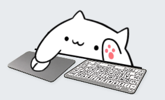

# v0.2.0 · 无白桌桌宠场景

发布日期：2026-11-22

本版把 BongoCat standard 桌宠从官方「白桌托板」改成真正的透明悬浮场景：鼠标垫、完整键盘和动态猫直接落在壁纸上，不再有白色方板、第二根桌线或被画布裁断的键鼠边缘。

## 下载

| 芯片 | 安装包 | 大小 |
|---|---|---|
| Apple Silicon（M1/M2/M3/M4） | `MacAppControlDeck-0.2.0-arm64.dmg` | 约 53 MB |
| Intel（x86_64） | `MacAppControlDeck-0.2.0-x86_64.dmg` | 约 53 MB |

同时提供 `.zip` 压缩包，内容与 DMG 中的 `.app` 相同。全部资产见 `SHA256SUMS.txt`。

确认芯片：苹果菜单 →「关于本机」，或终端执行 `uname -m`（`arm64` / `x86_64`）。

## 安装

1. 打开对应 DMG，把 `MacAppControlDeck.app` 拖入「应用程序」。
2. 首次启动如被 Gatekeeper 拦截：右键应用 →「打开」，或执行
   `xattr -dr com.apple.quarantine /Applications/MacAppControlDeck.app`。
3. 按首次配置授予「辅助功能」和「屏幕录制」权限，然后重启应用。

本版使用 ad-hoc 签名，**未经过 Apple 公证**，因此首次打开会有安全提示。没有自动更新，后续版本需手动下载覆盖。

## 本版内容

- 桌宠背景改为透明 `background.clean.png`：完整圆角鼠标垫、完整四角键盘，无白桌和桌线
- 动态 Live2D 猫保留眨眼、视线跟随、左右键和打字反馈
- standard 场景统一按 612×354 画布缩放，窗口比例保持 612×372
- 随包补充 BongoCat 上游 Apache-2.0 许可证原文与第三方来源说明
- 新增项目级重建手册 `.myflicker/skills/build-desktop-pet-scene/SKILL.md`



## 系统要求

- macOS 14 Sonoma 及以上
- Intel 或 Apple Silicon Mac
- 手机遥控需在同一局域网

## 已知限制

- **按键高亮坐标未重映射**：键位高亮仍沿用官方键盘像素坐标，替换为不同透视的新键盘后，按住字母键时蓝色高亮/猫爪落点可能与画面上键帽位置不一致。视觉场景已验收，逐键重映射留到后续版本。
- 整体缩放为 `0.94`，比官方 standard 场景小约 6%，用于保留窗口边距。
- 未公证、未接入 Sparkle 自动更新。
- 通信为局域网明文 HTTP，请只在可信网络使用。
- 滚动截图遇到固定侧栏/工具栏时可能出现重复区域。

## 对应变更

- OpenSpec：`openspec/changes/archive/2026-11-22-remove-pet-white-desktop/`
- 能力规格：`openspec/specs/pet-live2d-bongocat/spec.md`
- 回退分支：`backup/pet-before-noplate`（仅本地，不对外推送）

## 校验

```text
0f0232607564f9253036106e60085bf9aa963227aa7c5c4d7862a972c9325cd4  MacAppControlDeck-0.2.0-arm64.zip
97f9c3bae5feff05d6363820e46958019bde0741f488ccd4a55acf87d035b3b8  MacAppControlDeck-0.2.0-arm64.dmg
97a9cf10336015da3bfe9f93339de2faa59d4de93e4227f2c2e693ee47eb2ee3  MacAppControlDeck-0.2.0-x86_64.zip
2692e06689fbacacd1f4f9d904deb526cf8ba77226f9a49dfc0cd3a6fc51fe6f  MacAppControlDeck-0.2.0-x86_64.dmg
```
