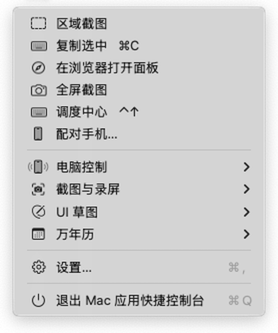
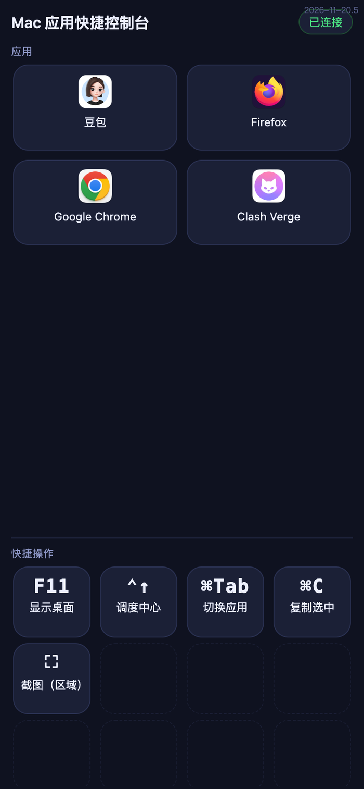
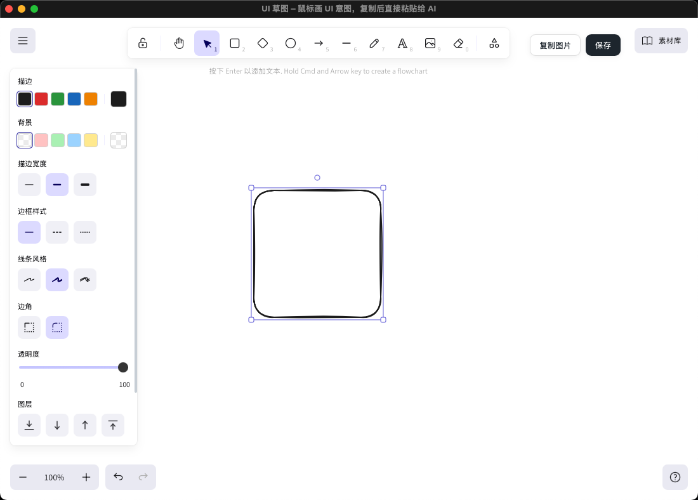
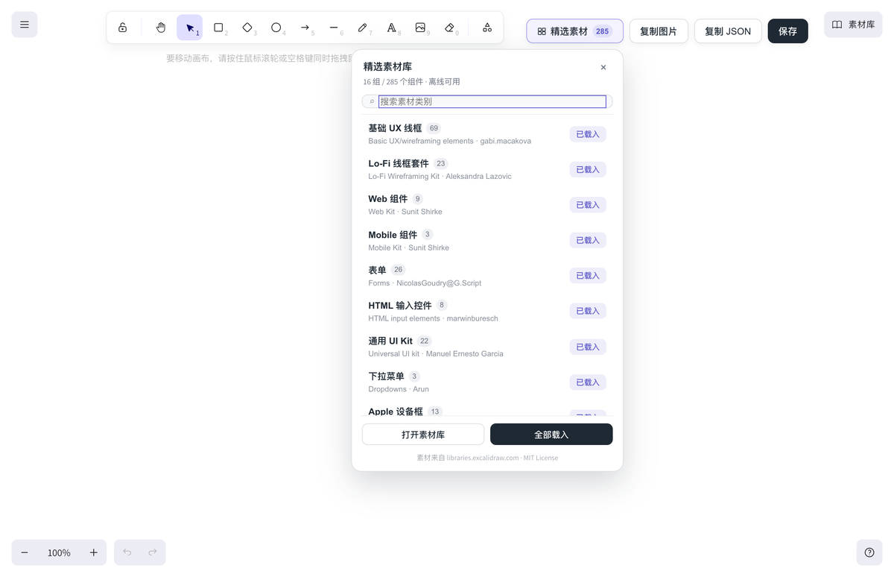
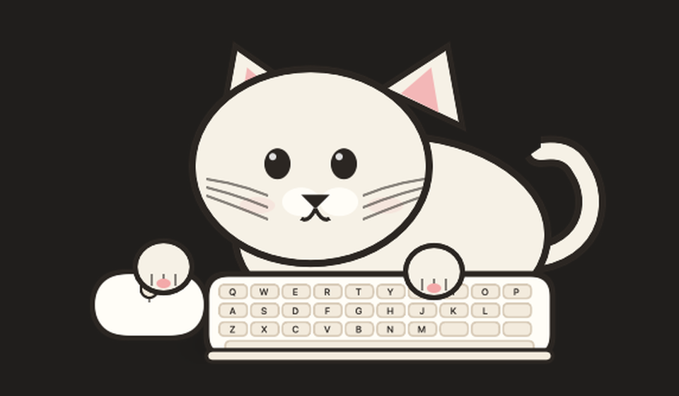
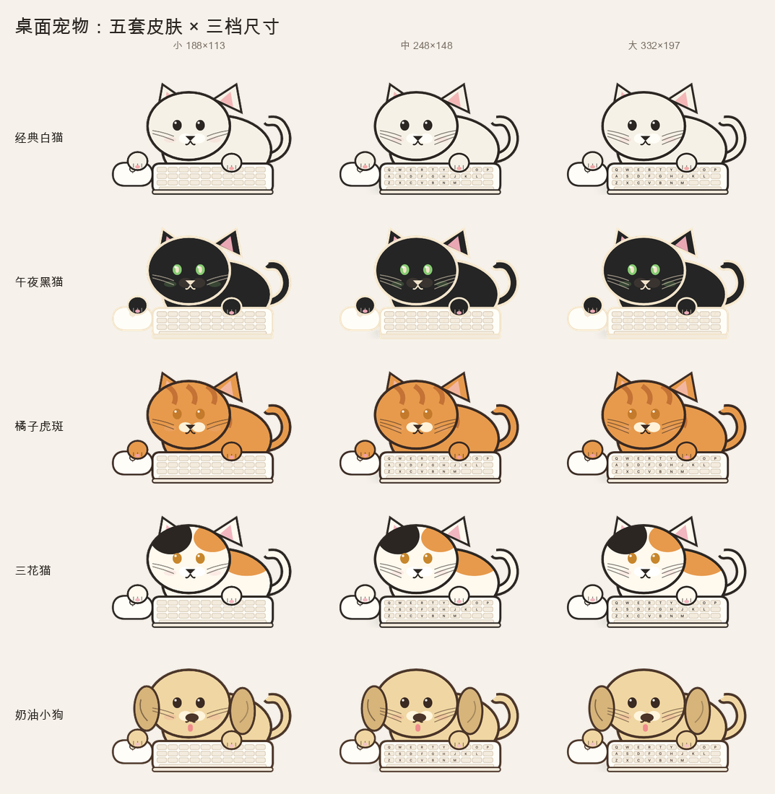
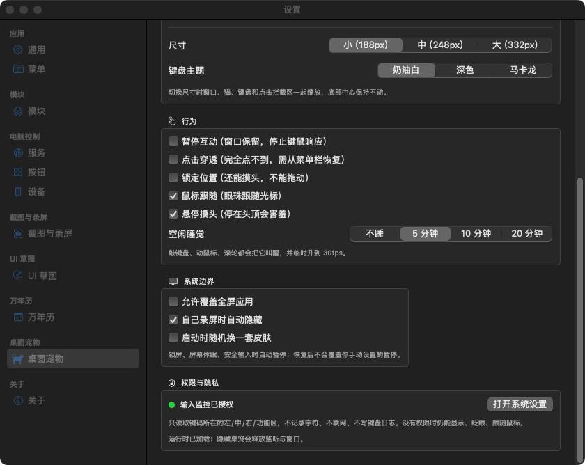
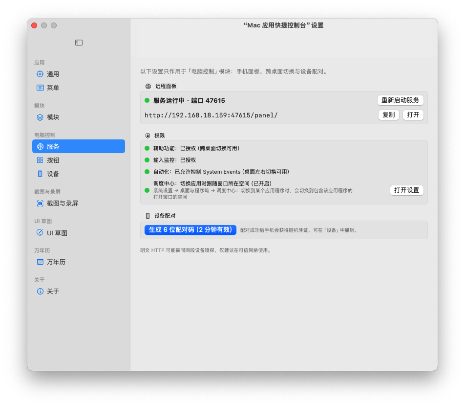
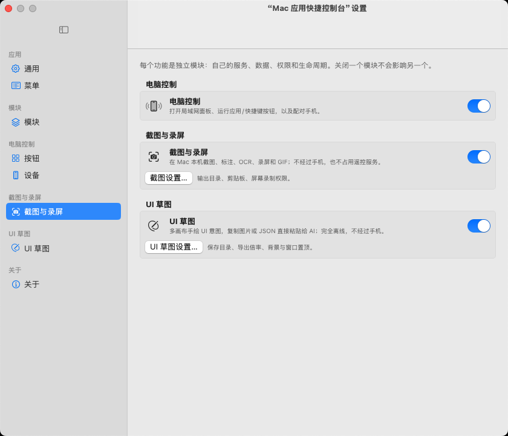
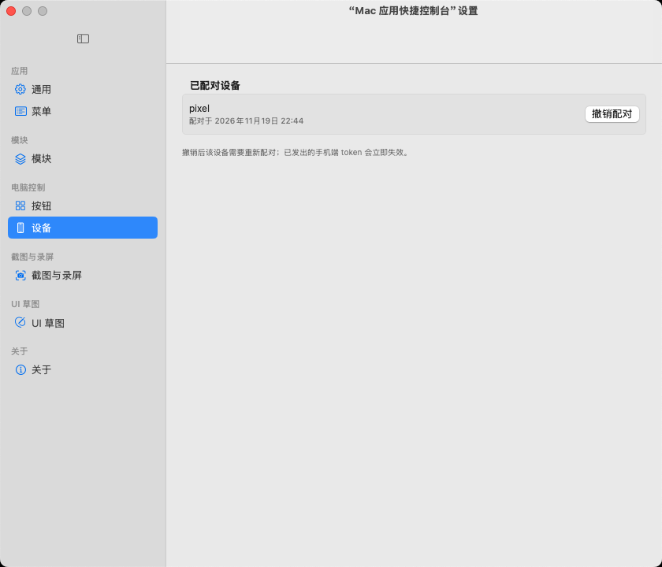

# MacAppControlDeck · Mac 应用快捷控制台

在局域网内用 iPhone / iPad / Android 的浏览器遥控 Mac：点击按钮即可启动或激活对应应用，自动切换到应用窗口所在的虚拟桌面并置于前台。无云服务、无公网、无注册账号。

同时按“功能模块”组织：电脑遥控、截图/录屏、UI 草图、万年历与桌面宠物是彼此独立的模块，各自拥有服务、数据、权限和生命周期。截图/录屏、UI 草图、万年历与桌面宠物在 Mac 本机使用，不经过手机。

<table>
<tr>
<td width="58%" align="center"></td>
<td width="42%" align="center"></td>
</tr>
<tr>
<td align="center"><sub>Mac 菜单栏：应用、快捷操作、截图录屏、UI 草图、设置</sub></td>
<td align="center"><sub>手机端：已配对后的应用与快捷操作面板</sub></td>
</tr>
</table>

> 下文截图全部来自本机实际运行，覆盖菜单栏、设置页、截图/录屏、UI 草图、万年历、桌面宠物与手机面板。

需求与设计见 `openspec/`（OpenSpec 管理，变更 `add-core-control-loop`）。

---

## 功能

- **一键启动 / 切换应用**：手机点按钮 → 应用启动或切到前台；窗口在其他「桌面空间」时自动跳过去
- **跨桌面切换**：通过「按下 Dock 图标」实现，与真人点击 Dock 完全等价，复用系统调度中心的跨空间规则
- **按钮管理**：Mac 端搜索添加应用（按 Bundle ID 绑定）、重命名、排序、删除（有确认）
- **配对与撤销**：6 位一次性配对码（2 分钟、错 3 次作废），已配对设备可随时撤销
- **菜单栏常驻**：应用只占菜单栏，不占 Dock；下拉菜单直接点应用 / 快捷操作 / 命令
- **截图与录屏（Mac 本机模块）**：全屏 / 区域 / 窗口 / 滚动截图，截图延时、快速保存、快速 OCR；标注编辑器（矩形、椭圆、直线、箭头、画笔、荧光笔、文字、序号、马赛克、模糊、聚光灯、测量、裁剪）；OCR、钉图、最近截图历史；PNG/JPEG/HEIC/WebP/AVIF 输出
- **录屏（Mac 本机模块）**：区域 / 全屏 / 窗口 MP4（H.264 + 系统音频，真实帧时序），15/30/60/120 fps；区域 GIF（5/10/15 fps）；3-2-1 倒计时；顶部录制 HUD 与录制边框；磁盘不足/休眠自动停止
- **视频剪辑**：多段剪切、0.5–4× 变速、字幕（可指定起止时间）、分轨音量、MP4 导出进度/取消、直接导出 GIF
- **UI 草图（Mac 本机模块）**：离线 Excalidraw 画板，多画布独立保存；左上角「画布」下拉可新建、重命名、删除并顺滑切换，每张画布保留各自内容与视口；鼠标手绘 UI 意图，矩形、箭头、文字、便签、粘贴截图齐全；有选中复制选中、无选中复制整板，PNG 直接粘贴给 AI；也可「复制 JSON」，导出带 `isDiagram` / `ai.kind=diagram` 说明的场景文本 JSON，AI 能明确知道这是图；同时保存 PNG 与 `.excalidraw` 源文件到 `~/Pictures/MacAppControlDeck/Sketches`；内置 16 组离线精选素材库（285 个组件、1531 个元素，来自 Excalidraw 官方素材库，MIT），顶部「精选素材」可按类别载入，原生「素材库」按钮直接取用；全局快捷键 `⌃⌥D`；默认打开画板才创建窗口与 WebView，关闭窗口释放，设置可开「常驻内存」
- **万年历（Mac 本机模块）**：独立日历窗口，农历、干支生肖、节气、传统节日、宜忌与法定节假日 `休/班` 角标；默认打开才加载，关闭窗口释放；设置里可开启「常驻内存」
- **桌面宠物（Mac 本机模块）**：Bongo Cat 风格透明置顶桌宠，跟随键盘/鼠标做出左右爪、键盘分区高亮、组合键惊讶、眨眼、呼吸、睡觉与悬停摸头；三档尺寸、五套皮肤（白猫 / 黑猫 / 橘猫 / 三花 / 小狗）、三套键盘主题；按轮廓点击穿透，无输入监控权限时降级为静态陪伴；隐藏即释放窗口、输入监听与动画资源
- **模块开关**：设置 →「模块」可独立启用/关闭电脑遥控、截图录屏、UI 草图、万年历与桌面宠物，关闭一个不影响另一个
- **保存体验**：系统快门音、`{date}/{time}/{app}` 文件名模板（可分子文件夹）、保存后右下角悬浮缩略图（点击再编辑 / 拖出为文件）、缩略图网格截图历史
- **手机端面板**：静态单页 Web，可「添加到主屏幕」当 App 用；明文局域网 HTTP

## 开发规则

新增任何用户可见功能、窗口或模块时，必须同时提供**内置快捷打开按钮**：

- 在 `BuiltinActions` 注册 `<feature>.open`，名称为「打开 X」
- 可从「设置 → 按钮管理 → 添加按钮 → 添加内置操作」一键添加
- 添加后同步出现在菜单栏「快捷操作」和手机面板「快捷操作」区
- 点一下必须真的能打开目标功能

完整规则与反例见 `AGENTS.md` 与 `Docs/architecture/MODULES.md` 的 R9。

## 环境要求

- macOS 14+（构建工具链 Swift 5.9+）
- 手机与 Mac 在同一局域网

## 下载安装

从 [Releases](https://github.com/AdrianAndroid/MacAppControlDeck/releases) 下载对应芯片的安装包：

| 芯片 | 资产 |
| --- | --- |
| Apple Silicon（M 系列） | `MacAppControlDeck-<版本>-arm64.dmg` |
| Intel | `MacAppControlDeck-<版本>-x86_64.dmg` |

终端执行 `uname -m` 可确认芯片（`arm64` / `x86_64`）。发布包为 ad-hoc 签名、未公证，首次打开需右键「打开」或在「隐私与安全性」中允许。

## 构建与安装

```zsh
./Build/setup-signing.sh   # 可选：创建稳定自签名证书（无 Apple 开发证书时建议执行一次）
./Build/build.sh           # swift build -c release + 组装 .app + 签名 + 图标
open BuildOutput/MacAppControlDeck.app
```

安装到「应用程序」目录：

```zsh
cp -R BuildOutput/MacAppControlDeck.app /Applications/
open /Applications/MacAppControlDeck.app
```

生成双架构发布包（DMG + ZIP + 校验和）：

```zsh
./Build/package-release.sh arm64
./Build/package-release.sh x86_64
```

> **为什么需要稳定证书**：辅助功能授权（TCC）按签名绑定。ad-hoc 签名每次重新构建都会变，系统会保留旧授权条目但实际不信任（表现为「开关是开的、授权却不生效」）。用固定证书（Apple Development 或自签名）后，重新构建不再需要重新授权。

运行后：菜单栏出现滑块图标，Dock 也有图标。App 自动在本机局域网 IP 上监听（默认端口 47615，被占用自动 +1），窗口首屏显示面板地址（形如 `http://192.168.x.x:47615/panel/`），可点击复制。

## 首次配置（按顺序）

### 1. 授予「辅助功能」权限（强烈建议）

系统设置 → 隐私与安全性 → 辅助功能 → 点 `+` 添加 `/Applications/MacAppControlDeck.app`，确认开关为开，**然后重启本程序**。

- 授权后：跨桌面切换走「Dock 图标点击」，最可靠（JetBrains 类应用的卡死态也能一次点开）
- 未授权：只能使用常规激活 API，对「窗口在其他桌面空间」的应用可能只标记前台、不跳桌面
- App 窗口内有状态灯（2 秒轮询）：绿色=已授权，橙色=未授权，附「去授权」按钮一键跳转

### 2. 打开调度中心开关（必须）

> 系统设置 → 桌面与程序坞 → 调度中心（Mission Control）→
> **「切换到某个应用程序时，会切换到包含该应用程序的打开窗口的空间」**

- 它不一定默认开启（本机调试期间就是关的），且位置不显眼，建议直接搜索「空间」
- 开关关闭时：点按钮只切菜单栏、不跳桌面，看起来像程序故障
- 判断方法：**手动点 Dock 图标也不跳桌面 → 就是这个开关的问题**
- 本程序不修改该设置

## Mac 端使用（菜单栏）

1. 启动后应用只出现在菜单栏（`slider.horizontal.3` 图标），没有 Dock 图标，也不开主窗口
2. 点菜单栏图标打开下拉菜单：
   - 顶部显示当前面板地址，可直接「在浏览器打开面板」或「复制面板地址」
   - 「应用」「快捷操作」子菜单就是已配置的功能按钮，点一下立即执行（应用带真实图标）
   - 「截图与录屏」子菜单：全屏 / 区域 / 窗口 / 滚动截图；快速保存、快速 OCR；录制 MP4 / GIF；截图延时；最近截图；输出到 `~/Pictures/MacAppControlDeck` 与 `~/Movies/MacAppControlDeck`
   - 「UI 草图」子菜单：打开画板（`⌃⌥D`）/ 新建 / 复制当前草图（`⌘⇧C`）/ 保存 PNG 与源文件（`⌘S`）/ 最近草图 / 保存目录
   - 「万年历」子菜单：今日公历、农历、宜忌、节假日倒计时；「打开万年历…」进入独立日历窗口
   - 「桌面宠物」子菜单：打开/隐藏、暂停互动、点击穿透、三档尺寸、五套皮肤、重置位置与设置页；全局快捷键 `⌃⌥P`
   - 「配对手机…」生成 6 位配对码并打开设置
   - 「设置…」进入首选项（⌘,），「退出」结束服务（⌘Q）
3. 关闭设置窗口不会退出服务；菜单栏图标常驻，服务继续监听端口


<sub>电脑控制子菜单：面板地址、在浏览器打开面板、应用、快捷操作、配对手机、重启服务。</sub>

## 截图、录屏与视频剪辑

截图/录屏是独立的 Mac 本机模块：不经过手机，也不占用遥控服务。菜单栏「截图与录屏」提供全屏、区域、窗口、滚动截图，以及 MP4 / GIF 录制和截图历史。全局快捷键 **`F1`** 或 `⌘⇧X` 可直接打开区域截图。

<table>
<tr>
<td width="40%"></td>
<td width="60%"></td>
</tr>
<tr>
<td align="center"><sub>菜单栏子菜单：截图、OCR、录屏、GIF、最近截图</sub></td>
<td align="center"><sub>设置页：保存/剪贴板/快门音、命名模板、格式与质量、录屏目录</sub></td>
</tr>
</table>


<sub>区域截图：桌面变暗后拖选区域；窗口自动高亮，可按 `F` 切全屏，选好后进入标注编辑器。</sub>

使用方式：

1. **截图**：按 `F1` 或 `⌘⇧X` 直接进入区域截图；也可菜单栏 → 截图与录屏 → 全屏 / 区域 / 窗口 / 滚动截图。`快速保存（区域）` 直接写文件，`快速 OCR（区域）` 直接识别文字
2. **标注**：截图后进入标注编辑器，可加矩形、椭圆、箭头、画笔、文字、序号、马赛克、模糊、聚光灯、测量与裁剪，再复制或保存
3. **钉图**：编辑器里钉到屏幕，或菜单栏「钉剪贴板内容」，用于对照抄写、比对设计稿
4. **录屏**：录制屏幕（区域 / 全屏）/ 窗口，可选系统声音与麦克风、鼠标指针、15–120 fps；录制时有顶部 HUD 与边框，可随时停止
5. **视频剪辑**：录制完成后可多段剪切、0.5–4× 变速、加字幕、调分轨音量，导出 MP4 或 GIF

默认输出：截图到 `~/Pictures/MacAppControlDeck`，录屏到 `~/Movies/MacAppControlDeck`；均可在设置页修改。

> `F1` 是全局快捷键，其他应用在前台也能触发。若 Apple 键盘把 F1 用作亮度调节，请在「系统设置 → 键盘」开启「将 F1、F2 等键用作标准功能键」，或按 `fn + F1`。

## UI 草图

完全离线的 Excalidraw 画板，用来快速画 UI 线框/流程，再把图片或 JSON 直接粘给 AI。全局快捷键 `⌃⌥D` 打开画板。

默认 `resident=false`：启动不加载画板，第一次打开才创建 `SketchRuntime`（窗口、WebView、Store 与画布索引），关闭窗口后整体释放。设置 → UI 草图可开启「常驻内存」，此时关闭窗口只保留轻量控制器与 Store，WebView 仍然销毁；关闭开关且窗口已关闭时立即释放。菜单、快捷键、内置操作与设置页按钮全部走 `SketchModule` 代理。



使用方式：

1. **新建画布**：左上角「画布」下拉新建/重命名/删除，每张画布独立保存内容与视口；`⌘N` 也可新建
2. **手绘**：矩形、椭圆、箭头、文字、便签、自由画笔齐全，支持网格、吸附、图层与透明度
3. **载入素材**：顶部「精选素材」内置 16 组、285 个组件、1531 个元素（Excalidraw 官方素材库，MIT），可搜索、分类载入；也可用原生「素材库」侧栏
4. **交给 AI**：选中后「复制图片」只复制选中对象，不选则复制整板；「复制 JSON」输出带 `isDiagram` / `ai.kind=diagram` 的场景 JSON
5. **保存**：`⌘S` 或「保存」会同时写 PNG 与同名 `.excalidraw` 源文件到 `~/Pictures/MacAppControlDeck/Sketches`
6. **内存**：默认打开才加载、关闭即释放；设置 →「UI 草图 → 常驻内存」开启后，关闭窗口只保留轻量控制器与 Store，WebView 仍销毁



## 万年历

独立日历窗口，参考中文日历的信息密度：公历大数字、农历小字、节气/节日彩色标记、法定节假日 `休/班` 角标，底部是选中日期的干支生肖与宜忌。


使用方式：

1. **入口**：菜单栏「万年历 → 打开万年历…」，或手机面板/菜单栏快捷操作里的「万年历」按钮
2. **查看**：默认周一开头，可前后翻月、回到今天；点击日期切换底部详情
3. **节假日**：法定休息日显示绿色 `休`，调休上班显示橙色 `班`；底部显示下一个节假日倒计时
4. **内存**：默认「打开才加载，关闭即释放」。设置 →「万年历 → 常驻内存」开启后，关闭窗口仍保留历法数据，再次打开更快；关闭开关且窗口已关闭时立即释放
5. **隐私**：纯本地 LunarSwift 计算，不联网、不读取系统日历/提醒、不申请定位与通讯录权限

<table>
<tr>
<td width="45%"></td>
<td width="55%"></td>
</tr>
<tr>
<td align="center"><sub>设置：常驻内存、周一/周日起始、隐私说明</sub></td>
<td align="center"><sub>月历、节气/节日、休/班、宜忌与节假日倒计时</sub></td>
</tr>
</table>

## 桌面宠物

Bongo Cat 结构的原生桌宠：白猫趴在桌沿，左爪搭鼠标、右爪搭迷你键盘，敲键盘时对应分区亮起、爪子起落，鼠标移动时眼珠跟随。窗口无边框、透明、置顶且不抢焦点；只有身体和键盘区域拦截点击，透明留白直接穿透到下层应用。



<table>
<tr>
<td width="62%"></td>
<td width="38%"></td>
</tr>
<tr>
<td align="center"><sub>五套皮肤 × 三档尺寸，窗口、猫、键盘与拦截轮廓同步缩放</sub></td>
<td align="center"><sub>设置页：实时预览、皮肤、尺寸、键盘主题、行为与权限</sub></td>
</tr>
</table>

使用方式：

1. **打开**：菜单栏「桌面宠物 → 打开桌宠」，或按 `⌃⌥P`，也可在「设置 → 按钮 → 添加内置操作」中添加「打开桌面宠物」，之后从菜单栏「快捷操作」与手机面板触发
2. **换肤**：经典白猫、午夜黑猫、橘子虎斑、三花猫、奶油小狗；换肤时保持窗口位置与尺寸，键盘主题可单独切换奶油白 / 深色 / 马卡龙
3. **调尺寸**：小 `188×113` / 中 `248×148` / 大 `332×197`；以底部中心为锚点缩放，靠近屏幕边缘时自动夹回可见区域
4. **互动**：拖拽身体移动；右键菜单可暂停、锁定、点击穿透、换肤、调尺寸、重置位置；悬停头顶会害羞，长时间无输入会睡觉，按任意键唤醒
5. **自动避让**：全屏应用、屏幕锁定/休眠、Secure Input、低电量与自带录屏期间自动暂停或隐藏；恢复后继续，且不覆盖手动暂停
6. **隐私与降级**：输入监听只读 `keyCode`，不记录字符、不联网；没有「输入监控」权限时仍能显示、眨眼和跟随鼠标，设置页提供授权入口

默认位置在主屏右下角 Dock 上方 24pt；位置按显示器分别保存，隐藏后释放 `PetRuntime` 与 `CGEventTap`。

## 手机端使用

1. 手机与 Mac 连接同一 Wi-Fi
2. Safari 打开 Mac 端显示的面板地址
3. 点击 Mac 菜单栏「配对手机…」（或设置 → 电脑控制 → 服务 → 生成 6 位配对码），在手机输入 → 配对成功，显示按钮列表
4. （可选）Safari 分享 → 添加到主屏幕，之后像 App 一样全屏使用

点击按钮后的状态行会如实显示结果（`已切换到前台` / `已启动并切到前台` / 具体失败原因）。

<table>
<tr>
<td width="50%" align="center"></td>
<td width="50%" align="center"></td>
</tr>
<tr>
<td align="center"><sub>首次打开：输入 Mac 端生成的 6 位配对码</sub></td>
<td align="center"><sub>配对后：应用按钮 + 快捷操作，可直接添加到主屏幕</sub></td>
</tr>
</table>

## 添加 / 管理按钮（Mac 端）

菜单栏 →「设置…」→「按钮」标签页：

- 「添加按钮」→「添加应用按钮…」搜索选择应用（按 Bundle ID 绑定）；也可添加「快捷操作」或「命令按钮」
- 每行支持「⋯ → 重命名…」、↑↓ 排序、「⋯ → 删除…」（删除有确认）
- 应用被删除/移动后按钮显示「应用缺失」，可回到 App 列表重新绑定
- 「设备」标签页可撤销任意设备的配对（撤销后旧凭证立即失效）

## 设置界面

所有配置集中在「设置…」（`⌘,`）里，左侧按应用、模块与电脑控制分组：

<table>
<tr>
<td width="50%"></td>
<td width="50%"></td>
</tr>
<tr>
<td align="center"><sub>通用：登录启动、数据与日志目录</sub></td>
<td align="center"><sub>菜单：置顶命令、各模块命令显隐与上下排序</sub></td>
</tr>
<tr>
<td></td>
<td></td>
</tr>
<tr>
<td align="center"><sub>服务：远程面板、权限状态、配对码</sub></td>
<td align="center"><sub>截图与录屏：保存、格式、延时与录制</sub></td>
</tr>
<tr>
<td></td>
<td></td>
</tr>
<tr>
<td align="center"><sub>模块：独立开关电脑控制、截图录屏、UI 草图与万年历；可选模块支持常驻内存</sub></td>
<td align="center"><sub>UI 草图：打开画板、保存目录、导出倍率与背景、常驻内存</sub></td>
</tr>
<tr>
<td></td>
<td></td>
</tr>
<tr>
<td align="center"><sub>万年历：常驻内存、周一/周日起始、隐私说明</sub></td>
<td align="center"><sub>桌面宠物：实时预览、五套皮肤、尺寸、键盘主题与权限</sub></td>
</tr>
<tr>
<td></td>
<td></td>
</tr>
<tr>
<td align="center"><sub>设备：查看已配对设备并随时撤销，旧 token 立即失效</sub></td>
<td></td>
</tr>
</table>

## 激活策略（简述）

点击按钮后的执行顺序：

1. **应用未运行** → `openApplication` 启动 → 等进程出现 → 进入激活流水线
2. **已运行** → 按优先级尝试：
   - **Dock 图标 AXPress**（辅助功能）：由 Dock 进程执行激活，等价真人点击，跨空间原生生效
   - **AXRaise 目标窗口**：应用不在 Dock 时使用，会顺带取消最小化
   - **`activate(from:)` / LSOpen**：公开 API 兜底
3. **成功判定**：目标应用是否成为前台应用。窗口可见性只记诊断日志——进程内 `CGWindowList` 数据在真机上与其他进程不一致，不可作为判定依据

详细原理、实测记录与取舍见 `openspec/changes/archive/2026-11-19-add-core-control-loop/design.md`。

## 安全边界（务必阅读）

- 手机只能执行白名单动作：列出按钮、激活某个已配置按钮；**不能**执行任意 shell / 任意应用
- 所有接口要求配对换发的随机 token（配对码 2 分钟有效、错 3 次作废）
- 通信为**明文 HTTP**：同网段设备理论上可嗅探到 token/配对码，请仅在可信家庭局域网使用；HTTPS 为后续评估项
- 程序不修改系统设置、不默认开机自启；电脑遥控使用可选的辅助功能授权，截图/录屏使用屏幕录制授权（仅在使用 capture 模块时申请），两者互不影响
- 数据存放在 `~/Library/Application Support/MacAppControlDeck/`（`buttons.json` / `devices.json` / `icons/`），程序重启后保留

## 快捷操作与命令按钮

「快捷操作」分组支持两类按钮：

- **按键组合**：预设（桌面左/右、⌘C、⌘V、⌘A、⌘Z、回车、Esc、F1–F12）或自定义录制/拼凑。适用于普通应用（编辑、IDE 等）。
- **命令按钮**：执行某个应用内置的命令行（例如 Snipaste 的 `snip`），参数只在 Mac 端配置，手机端仍只发送按钮 ID。

> **已知限制**：Snipaste 等注册系统级热键的应用会忽略注入的按键（F1 对其无效，已实测输入监控授权也不能解决），因此这类应用请用**命令按钮**方式触发（例：应用选 Snipaste、参数 `snip`）。

**连续点击**：每个按钮有独立队列（上限 8 条），点击立即入队、按顺序执行、不阻塞后续点击；系统会按操作类型设置超时（快捷操作 2.5s、命令 4s、应用 20s），超时的命令自动放弃并继续执行队列，无需等待提示消失。

## 测试

```zsh
swift test     # 84 项，含真实 TCP 服务器与真实应用激活的端到端用例
```

## 已知限制

- 最小化窗口的恢复由系统/应用决定；无法确认时如实反馈，不谎报
- 无可见窗口的应用（菜单栏类）激活后不新建窗口（依应用自身行为）
- 没有 Dock 图标的应用无法使用 Dock 点击路径，跨空间能力受限
- iOS 主屏幕 Web App 与 Safari 的 localStorage 互相独立，两端需分别配对一次
- Mac IP 变化后需重新扫码打开新地址（可能需重新配对）
- Mac 休眠/锁屏/退出后不可用，手机会显示「Mac 未连接」（属设计行为）
- 滚动截图是自动向下滚动 + 重叠拼接；如果选区包含固定侧栏/固定工具栏，长图里会重复出现这些固定区域，建议只框选可滚动内容
- 上传（Google Drive / imgbb / S3）、翻译、Sparkle 自动更新、账号体系不移植；详细对照见 [Docs/architecture/MACSHOT_PORT.md](Docs/architecture/MACSHOT_PORT.md)

## 故障排查

| 现象 | 处理 |
| --- | --- |
| 手机显示「Mac 未连接」 | 确认 Wi-Fi 同网段、Mac 端 App 正在运行；Mac 休眠会断开 |
| 面板要求重新配对 | 凭证失效或被撤销，在 Mac 端重新生成配对码 |
| 按钮显示「应用缺失」 | 应用已卸载/移动，在 Mac 端重新绑定 |
| 端口冲突 | 服务自动尝试 47615–47634，以窗口显示地址为准 |
| 点击无反应 | 看按钮下状态行：失败原因会原样显示（如「启动失败：…」） |
| 面板地址是 169.254.x.x、手机访问不到 | 该地址属于未联网的网卡（常见于有线口 en0 没插网线、Wi-Fi 实际是 en1）。本版已改为「可路由地址优先」，若仍显示 169.254 请检查网络连接 |
| Android Chrome 一直转圈/提示无法连接 | 浏览器把 `http://` 强制升级成 HTTPS，而服务只支持明文 HTTP。完整输入 `http://IP:端口/panel/`，关闭 Chrome「始终使用安全连接」（或 `chrome://flags/#https-upgrades` 设为 Disabled），也可改用 Firefox |
| 配对提示成功但仍停在配对页 | 旧版在「按钮数为 0」时会退回配对页；本版已修复为进入主界面并显示空状态，按提示在 Mac 端添加按钮即可（面板 5 秒自动刷新） |
| 点击后只切菜单栏、不跳桌面 | ①检查调度中心开关（见上）；②检查辅助功能状态灯是否绿色。手动点 Dock 图标也不跳桌面即为开关问题 |
| 辅助功能状态灯一直橙色 | TCC 记录绑定了旧签名：删除该条目，重新添加 `/Applications/MacAppControlDeck.app`，再重启程序 |
| 已授权屏幕录制却仍提示授权 | ad-hoc 签名每次构建都会变，系统会保留旧条目而 `CGPreflightScreenCaptureAccess` 误报未授权。本版会先用真实窗口抓取探针确认，能抓到画面就不再弹窗；若仍提示，删除系统设置里的旧条目重新添加，或执行 `Build/setup-signing.sh` 固定证书后授权一次 |
| F1 触发不了 Snipaste 等全局热键应用 | 已知限制：请改用「命令按钮」（应用选 Snipaste、参数 `snip`）。普通应用中 F1 可正常注入 |
| F1 不打开区域截图 | ①Apple 键盘默认把 F1 当亮度键：开启「将 F1、F2 等键用作标准功能键」或按 `fn + F1`；②F1 被其他程序占用：本程序每 2 秒自动重试，重试期间用 `⌘⇧X` |
| 手机端 F1 按钮没有发到目标应用 | 已知限制：应用运行期间 Deck 的全局 F1 优先，会打开区域截图。需要向目标应用发送 F1 时，先退出 Deck 或改用命令按钮 |
| 点击启动台/系统界面后显示"未确认" | 启动台等系统界面不会以常规应用注册进程，属正常；已打开即可用 |
| 快捷键提示"当前处于安全输入状态" | 密码框/锁屏等安全输入场景会屏蔽按键注入，退出安全输入后重试 |
| 桌面左/右切换无反应 | 检查「自动化」权限：系统设置 → 隐私与安全性 → 自动化 → 勾选 MacAppControlDeck → System Events；并确认系统键盘快捷键「向左/向右切换桌面」为默认的 ⌃←/⌃→ |
| 重新构建后授权失效 | 确认 `build.sh` 输出了「已使用签名身份：…」而不是「ad-hoc 签名」；必要时执行 `setup-signing.sh` 并在钥匙串中信任该证书 |

运行日志：`~/Library/Application Support/MacAppControlDeck/logs/activation.log`（含每条激活策略的执行结果）。

## 项目结构

```
Sources/MacAppControlDeck/
├── App/DeckApp.swift            # 入口：菜单栏应用（无主窗口）
├── App/DeckState.swift          # remote 模块运行状态（服务/权限/配对/按钮/设备）
├── Core/                        # 模块协议、注册表、菜单/设置壳（不放业务逻辑）
├── Modules/
│   ├── RemoteControl/           # 电脑遥控模块：HTTP 服务/配对/手机面板/按钮
│   ├── Capture/                 # 截图与录屏模块：Mac 本机使用，不接 HTTP
│   ├── Sketch/                  # UI 草图模块：轻量代理 + 按需 runtime，关闭窗口释放
│   ├── Calendar/                # 万年历模块：轻量代理 + 按需 runtime，关闭窗口释放
│   └── Pet/                     # 桌面宠物模块：透明 NSPanel + CGEventTap + 按需 runtime
├── Control/AppControl.swift     # 激活流水线（Dock AXPress / AXRaise / 兜底）
├── Control/QuickActionRunner.swift # 菜单栏按钮执行器（与 HTTP 接口同源）
├── Server/                      # remote 模块：NWListener HTTP 服务、路由
├── Store/                       # remote 模块：配置持久化、配对管理
├── UI/MenuBarController.swift   # NSStatusItem + NSMenu（按模块拼接菜单）
├── UI/SettingsView.swift        # 统一设置壳：按模块分区
├── UI/ButtonsSettingsView.swift # remote 模块：按钮管理
└── Panel/PanelHTML.swift        # remote 模块：手机端单页 Web 面板
Sources/MacShotKit/              # macshot 上游功能代码，只允许 capture 模块 import
Web/sketch/                      # UI 草图 Web 包装层源码（Vite + React + Excalidraw）
Build/
├── build.sh                     # 构建/签名/打包（含图标），产出到 BuildOutput/
├── package-release.sh           # 按 arm64 / x86_64 生成可分发 DMG + ZIP
├── setup-signing.sh             # 一次性创建稳定自签名证书
├── make-icon.swift              # 生成 AppIcon.iconset
└── Info.plist                   # Bundle 元数据（含 Automation 用途说明）
BuildOutput/                     # 构建产物（.gitignore）
Docs/images/readme/             # README 功能截图（菜单栏、设置页、手机面板、UI 草图、桌面宠物）
Docs/architecture/MODULES.md     # 【强制】模块边界与隔离规则
Docs/architecture/UPSTREAM_PORTING.md # 上游开源集成方法、验收标准与踩坑记录
Docs/archive/                    # 历史归档
```

> 模块边界是硬约束：`remote`、`capture`、`sketch`、`calendar` 与 `pet` 各自拥有服务、数据、权限和生命周期，互不引用、互不混排。详见 [Docs/architecture/MODULES.md](Docs/architecture/MODULES.md)。

## 归档

- 2026-11-21 桌面宠物（Bongo Cat 结构、五套皮肤、三档尺寸、按轮廓点击穿透）：[Docs 记录](Docs/archive/2026-11-21-desktop-pet/SUMMARY.md) · [OpenSpec 变更](openspec/changes/archive/2026-11-21-add-desktop-pet/proposal.md) · [能力规格](openspec/specs/desktop-pet/spec.md)
- 2026-11-21 区域截图图标与设置信息架构修复：[Docs 记录](Docs/archive/2026-11-21-settings-ia-and-capture-icon/SUMMARY.md) · [OpenSpec 变更](openspec/changes/archive/2026-11-21-fix-settings-ia-and-capture-icon/proposal.md) · [设置规格](openspec/specs/settings-navigation/spec.md) · [菜单图标规格](openspec/specs/menu-item-icons/spec.md)
- 2026-11-21 UI 草图懒加载与释放：[Docs 记录](Docs/archive/2026-11-21-sketch-lazy-runtime/SUMMARY.md) · [OpenSpec 变更](openspec/changes/archive/2026-11-21-add-sketch-lazy-runtime/proposal.md) · [能力规格](openspec/specs/sketch-lazy-runtime/spec.md)
- 2026-11-21 万年历附加模块（菜单入口 + 独立窗口 + 懒加载释放）：[Docs 记录](Docs/archive/2026-11-21-chinese-calendar/SUMMARY.md) · [OpenSpec 变更](openspec/changes/archive/2026-11-21-add-chinese-calendar/proposal.md) · [能力规格](openspec/specs/calendar-window/spec.md)
- 2026-11-21 F1 区域截图全局快捷键：[Docs 记录](Docs/archive/2026-11-21-f1-capture-shortcut/SUMMARY.md) · [OpenSpec 变更](openspec/changes/archive/2026-11-21-add-f1-capture-shortcut/proposal.md) · [能力规格](openspec/specs/capture-overlay-parity/spec.md)
- 2026-11-21 README 功能截图与使用路径（需求归档）：[Docs 记录](Docs/archive/2026-11-21-readme-screenshots/SUMMARY.md) · [OpenSpec 变更](openspec/changes/archive/2026-11-21-add-readme-feature-screenshots/proposal.md) · [能力规格](openspec/specs/project-documentation/spec.md)
- 2026-11-19 MVP 0.1.0：[Docs/archive/2026-11-19-mvp-0.1.0/SUMMARY.md](Docs/archive/2026-11-19-mvp-0.1.0/SUMMARY.md)
- 2026-11-19 远程快捷操作（快捷键 / 命令按钮 / 桌面切换）经验总结：[Docs/archive/2026-11-19-remote-quick-actions/SUMMARY.md](Docs/archive/2026-11-19-remote-quick-actions/SUMMARY.md)
- 2026-11-19 构建补齐、局域网地址与面板配对修复：[Docs/archive/2026-11-19-build-network-panel-fixes/SUMMARY.md](Docs/archive/2026-11-19-build-network-panel-fixes/SUMMARY.md)
- 2026-11-20 UI 草图模块（离线 Excalidraw + 复制给 AI）：[Docs/archive/2026-11-20-sketch-module/SUMMARY.md](Docs/archive/2026-11-20-sketch-module/SUMMARY.md)
- 2026-11-19 菜单栏常驻 + 首选项结构重构：[Docs/archive/2026-11-19-menubar-restructure/SUMMARY.md](Docs/archive/2026-11-19-menubar-restructure/SUMMARY.md)
- 2026-11-19 模块骨架与本机全屏截图（P0 + P1）：[Docs/archive/2026-11-19-module-shell-and-capture/SUMMARY.md](Docs/archive/2026-11-19-module-shell-and-capture/SUMMARY.md)
- 2026-11-20 macshot 截图/录屏能力移植：[Docs/archive/2026-11-20-macshot-port/SUMMARY.md](Docs/archive/2026-11-20-macshot-port/SUMMARY.md)
- 上游集成方法论（复用开源实现的正确方式）：[Docs/architecture/UPSTREAM_PORTING.md](Docs/architecture/UPSTREAM_PORTING.md)
- 2026-11-20 截图覆盖层与 macshot 体验对齐（工具条搬运/Retina/权限/热键/钉图 Esc）：[Docs/archive/2026-11-20-capture-parity-and-experience/SUMMARY.md](Docs/archive/2026-11-20-capture-parity-and-experience/SUMMARY.md)
- 2026-11-20 录屏/GIF 录制覆盖层与编辑流程对齐：[Docs/archive/2026-11-20-recording-overlay-parity/SUMMARY.md](Docs/archive/2026-11-20-recording-overlay-parity/SUMMARY.md)
