# MacAppControlDeck · Mac 应用快捷控制台

当前版本：`0.4.1`（2026-11-24）

在局域网内用 iPhone / iPad / Android 的浏览器遥控 Mac：点击按钮即可启动或激活对应应用，自动切换到应用窗口所在的虚拟桌面并置于前台。无云服务、无公网、无注册账号。

同时按“功能模块”组织：电脑遥控、截图/录屏、UI 草图、万年历与桌面宠物是彼此独立的模块，各自拥有服务、数据、权限和生命周期。截图/录屏、UI 草图、万年历与桌面宠物在 Mac 本机使用，不经过手机。

<table>
<tr>
<td width="58%" align="center"></td>
<td width="42%" align="center">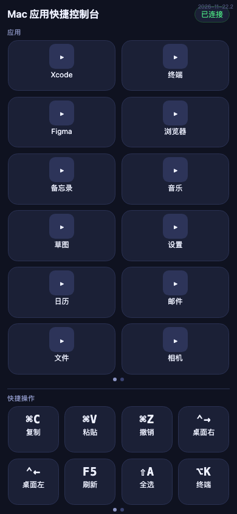</td>
</tr>
<tr>
<td align="center"><sub>Mac 菜单栏：应用、快捷操作、截图录屏、UI 草图、设置</sub></td>
<td align="center"><sub>手机端：竖屏应用 2 列 + 底部快捷 4×2；横屏切「左轨 + 12 应用 + 8 快捷」控制台</sub></td>
</tr>
</table>

> 下文截图全部来自本机实际运行，覆盖菜单栏、设置页、截图/录屏、UI 草图、万年历、桌面宠物与手机面板。

需求与设计见 `openspec/`；手机面板布局的最近一次变更见 `openspec/changes/archive/2026-11-22-adaptive-remote-panel-layout/`。

---

## 功能

- **一键启动 / 切换应用**：手机点按钮 → 应用启动或切到前台；窗口在其他「桌面空间」时自动跳过去
- **跨桌面切换**：通过「按下 Dock 图标」实现，与真人点击 Dock 完全等价，复用系统调度中心的跨空间规则
- **按钮管理**：Mac 端搜索添加应用（按 Bundle ID 绑定）、重命名、排序、删除（有确认）
- **配对与撤销**：6 位一次性配对码（2 分钟、错 3 次作废），已配对设备可随时撤销
- **菜单栏常驻**：应用只占菜单栏，不占 Dock；下拉菜单直接点应用 / 快捷操作 / 命令
- **全局快捷键可管且默认关闭**：设置 →「快捷键」首次安装时全部为关闭状态，需要哪个就打开哪个；可一键停用全部，也能单独关闭、录制改键或恢复默认组合；被其他应用占用时如实显示状态并自动重试。可选入口：截图 `F1` / `⌘⇧X`，草图 `⌃⌥D`，桌宠 `⌃⌥P`
- **截图与录屏（Mac 本机模块）**：全屏 / 区域 / 窗口 / 滚动截图，截图延时、快速保存、快速 OCR；标注编辑器（矩形、椭圆、直线、箭头、画笔、荧光笔、文字、序号、马赛克、模糊、聚光灯、测量、裁剪）；OCR、钉图、最近截图历史；PNG/JPEG/HEIC/WebP/AVIF 输出
- **录屏（Mac 本机模块）**：区域 / 全屏 / 窗口 MP4（H.264 + 系统音频，真实帧时序），15/30/60/120 fps；区域 GIF（5/10/15 fps）；3-2-1 倒计时；顶部录制 HUD 与录制边框；磁盘不足/休眠自动停止
- **视频剪辑**：多段剪切、0.5–4× 变速、字幕（可指定起止时间）、分轨音量、MP4 导出进度/取消、直接导出 GIF
- **UI 草图（Mac 本机模块）**：离线 Excalidraw 画板，多画布独立保存；左上角「画布」下拉可新建、重命名、删除并顺滑切换，每张画布保留各自内容与视口；鼠标手绘 UI 意图，矩形、箭头、文字、便签、粘贴截图齐全；有选中复制选中、无选中复制整板，PNG 直接粘贴给 AI；也可「复制 JSON」，导出带 `isDiagram` / `ai.kind=diagram` 说明的场景文本 JSON，AI 能明确知道这是图；同时保存 PNG 与 `.excalidraw` 源文件到 `~/Pictures/MacAppControlDeck/Sketches`；内置 16 组离线精选素材库（285 个组件、1531 个元素，来自 Excalidraw 官方素材库，MIT），顶部「精选素材」可按类别载入，原生「素材库」按钮直接取用；全局快捷键 `⌃⌥D`（默认关闭，可在设置 → 快捷键打开）；默认打开画板才创建窗口与 WebView，关闭窗口释放，设置可开「常驻内存」
- **万年历（Mac 本机模块）**：独立日历窗口，农历、干支生肖、节气、传统节日、宜忌与法定节假日 `休/班` 角标；默认打开才加载，关闭窗口释放；设置里可开启「常驻内存」
- **桌宠底部快捷栏**：桌宠下方一条半透明胶囊，只放手机 Deck 的「应用」按钮；点一下直接切换/启动应用，运行中的应用带绿点，最后一次点击的图标变浅。图标少时条宽收缩并相对桌宠居中，图标多时撑满桌宠宽度、长按横向拖动滚动（松手即停）；默认按点击频率排序（半衰期 7 天、冷却 30 分钟），不点不跳位；可在 设置 → 桌面宠物 →「底部快捷栏」开关、改排序、清空统计
- **桌面宠物（Mac 本机模块）**：设置中使用标签切换 BongoCat 白猫和 KeyCat 黑猫。BongoCat standard 官方 Live2D 透明桌宠——白猫趴在圆角鼠标垫与完整键盘前，左爪响应真实键盘、右爪响应鼠标左右键；53 个键位图与组合键 overlay，真机光标归一化跟随；去掉官方白桌托板，保留透明键鼠层；三档尺寸、按轮廓点击穿透、隐藏即释放资源
- **模块开关**：设置 →「模块」可独立启用/关闭电脑遥控、截图录屏、UI 草图、万年历与桌面宠物，关闭一个不影响另一个
- **自动升级**：菜单栏「检查更新…」/ 设置 →「通用 → 更新」从 GitHub Releases 拉新版本；默认每天后台检查一次、下载后由你确认重启，更新包需通过内置 EdDSA 公钥与固定签名身份双重校验，升级后不用重新授权
- **保存体验**：系统快门音、`{date}/{time}/{app}` 文件名模板（可分子文件夹）、保存后右下角悬浮缩略图（点击再编辑 / 拖出为文件）、缩略图网格截图历史
- **手机端面板**：静态单页 Web，可「添加到主屏幕」当 App 用；竖屏「应用 2 列 + 底部快捷 4×2」，横屏「左侧竖轨（标题/日期/时间/全屏/连接）+ 竖排标题 + 应用 4×3（12 个/页）+ 快捷 2×4（8 个/页）」；锁定视口，只保留横向翻页/页点与 `1/N` 页码，旋转保持当前页；明文局域网 HTTP
- **手机副屏**：独立地址 `/screen/` 的只读页面，横屏三栏「时钟 | 月历（含下班倒计时） | 天气」，天气栏按 MagicMirror 结构（城市、湿度/降水、大图标+温度、体感、现在+4 小时、5 天预报表）；免配对、不接触按钮与 token；横竖屏自适应、三档尺寸、屏幕常亮，适合把闲置手机当桌面表盘
- **PureMac 系统工具（Mac 本机模块）**：单一模块承载垃圾/缓存清理、应用卸载与残留、大文件、重复文件、菜单栏 CPU/MEM/实时网速监控、运行中应用退出/强制退出；清理默认展示路径与大小、默认不选中、优先移废纸篓，永久删除需单独二次确认；菜单栏 CPU/MEM/网速三个独立状态项可分别勾选显示与点击（点 MEM 弹出内存占用菜单、可一键退出应用），模块禁用时一并消失；网速用公开 API 差分采样、定宽显示不抖动、零 TCC 权限；清理引擎移植自 PureMac（MIT，momenbasel，见 `THIRD_PARTY_NOTICES.md`）。详见变更 `add-system-cleaner`、`add-menubar-netspeed`、`add-menubar-memory-menu`

## 开发规则

新增任何用户可见功能、窗口或模块时，必须同时提供**内置快捷打开按钮**：

- 在 `BuiltinActions` 注册 `<feature>.open`，名称为「打开 X」
- 可从「设置 → 按钮管理 → 添加按钮 → 添加内置操作」一键添加
- 添加后同步出现在菜单栏「快捷操作」和手机面板「快捷操作」区
- 点一下必须真的能打开目标功能

完整规则与反例见 `AGENTS.md` 与 `Docs/architecture/MODULES.md` 的 R9。

## 环境要求

- macOS 14+（构建工具链 Swift 5.9+）
- 手机与 Mac 在同一局域网

## 下载安装

从 [Releases](https://github.com/AdrianAndroid/MacAppControlDeck/releases) 下载安装包。v0.4.0 起只发布一份 universal（Apple Silicon + Intel 通用）包：

| 资产 | 用途 |
| --- | --- |
| `MacAppControlDeck-0.4.1-universal.dmg` | 首次安装（内含安装脚本与说明） |
| `MacAppControlDeck-0.4.1-universal-installer.zip` | 聊天软件传输用（解压后双击安装脚本） |
| `MacAppControlDeck-0.4.1-universal.zip` | 自动升级使用的更新包（App 在压缩包根目录，不用手动下载） |
| `appcast.xml` / `SHA256SUMS.txt` | 升级清单与校验和（`shasum -a 256 -c SHA256SUMS.txt`） |

**首次安装后就不用再手动下载**：菜单栏「检查更新…」或 设置 →「通用 → 更新」会自动从 GitHub Releases 拉新版本。

**给不熟悉命令行的朋友**：ZIP 解压后是一个文件夹，DMG 里也带这两个文件——除了 App，还有 `安装 MacAppControlDeck.command` 与 `安装说明.txt`；只能通过聊天软件传文件时，发 ZIP 最省事。双击脚本即可自动完成「复制到应用程序 → 解除下载隔离 → 启动 → 打开设置 - 桌面宠物」，任何一步出问题都会弹窗说明并指向 `/tmp/deck-install.log`；脚本被系统拦下时右键 → 打开即可。

终端执行 `uname -m` 可确认芯片（`arm64` / `x86_64`）。发布包未公证，首次打开需右键「打开」或在「隐私与安全性」中允许。本机执行 `package-release.sh` 时默认使用固定自签名身份；只有在没有该证书的机器上显式设置 `DECK_ALLOW_ADHOC=1` 才会生成 ad-hoc 包，而 ad-hoc 包每次重建都会重置系统授权，不建议安装到日常使用的 `/Applications`。

## 自动升级

v0.4.0 起内置 [Sparkle 2](https://sparkle-project.org) 自动升级，更新源是 GitHub Releases：

- **入口**：菜单栏「检查更新…」、设置 →「通用 → 更新 → 检查更新…」，或「设置 → 按钮 → 添加内置操作」添加「检查更新」后从菜单栏快捷操作 / 手机面板触发
- **自动检查**：默认开，每天一次（`SUScheduledCheckInterval=86400`），可在此开关关闭；断网或 GitHub 不可达时静默跳过，不弹窗
- **安装前确认**：下载完成后提示重启，用户点确认才替换 App；`SUAllowsAutomaticUpdates=false`，不会静默安装
- **校验**：更新包必须带 EdDSA 签名（公钥内置 `SUPublicEDKey`）且与本机 App 使用同一份固定自签名证书，否则拒绝升级——这样升级后辅助功能 / 输入监控 / 屏幕录制 / 自动化授权都不用重新授予
- **通用包**：`package-release.sh universal` 用 lipo 合并 arm64 + x86_64，appcast 只有一条记录，不会给 Intel 机器下 arm64 包
- **镜像 / 本地调试**：设置 `DECK_UPDATE_FEED=<appcast 地址>` 可临时改更新源（校验流程不变）

发版（**这台 Mac 是正式发版机**，本机一键完成）：

```zsh
# 1. 改 Build/Info.plist：CFBundleShortVersionString 与 CFBundleVersion 必须同时递增
# 2. 写 Docs/releases/<版本>.md，提交并推送 main
# 3. 自检，不改动任何线上状态：
./Build/publish-local.sh --verify-only
# 4. 预演：构建 + 签名 + 校验，不推 tag 不发布：
./Build/publish-local.sh --dry-run
# 5. 正式发布（自动创建 tag、上传 5 个资产、逐项复核线上结果）：
./Build/publish-local.sh
```

脚本自检 gh 登录、固定签名身份、EdDSA 私钥与内置公钥一致、main 与远程同步；随后构建 universal 包、用本机私钥签 appcast、校验架构 / designated requirement / SHA256 / edSignature，再创建 Release 并复核线上资产、appcast 与校验和。完整 SOP 见 [本机发布手册](Docs/releases/local-publish.md)。

私钥只放在本机 `~/.config/macappcontroldeck/sparkle_ed_key`（600 权限，不进仓库），与登录钥匙串的 `Private key for signing Sparkle updates`、仓库 Secret `SPARKLE_ED_PRIVATE_KEY` 是同一份；**禁止轮换 `SUPublicEDKey`**，否则 v0.4.1 存量用户的 Sparkle 升级链会断裂。CI 的 3 个 Secret（`DECK_SIGN_P12_BASE64`、`DECK_SIGN_P12_PASSWORD`、`SPARKLE_ED_PRIVATE_KEY`）仅兜底用；本机发布后 CI 检测到 Release 已存在会自动跳过，不会重复构建或覆盖资产。

## 构建与安装

首次在新机器构建时，先创建固定自签名证书；已有该证书则直接跳过：

```zsh
./Build/setup-signing.sh   # 首次必须执行，创建 MacAppControlDeck Self-Signed
./Build/build.sh           # swift build -c release + 组装 .app + 固定签名 + 图标
./Build/verify-signing.sh BuildOutput/MacAppControlDeck.app
open BuildOutput/MacAppControlDeck.app
```

安装到「应用程序」目录：

```zsh
cp -R BuildOutput/MacAppControlDeck.app /Applications/
./Build/verify-signing.sh /Applications/MacAppControlDeck.app
open /Applications/MacAppControlDeck.app
```

生成双架构发布包（DMG + ZIP + 校验和）：

```zsh
./Build/package-release.sh arm64
./Build/package-release.sh x86_64
```

> **固定签名规则**：本机构建与本地发布包默认使用固定身份 `MacAppControlDeck Self-Signed`（当前证书 SHA-1 `E83574620FE6CF96BA5A9C902F8B6A5C38F5A6B3`；证书重建后指纹会变化，见 `openspec/specs/stable-code-signing/spec.md`），其 designated requirement 必须包含 `certificate root = H"e83574620fe6cf96ba5a9c902f8b6a5c38f5a6b3"`。如果签名身份缺失，`build.sh` 会直接失败，不会静默退回 ad-hoc。辅助功能、输入监控、屏幕录制和自动化授权都绑定这个身份，因此重新构建后不需要反复授权；不要把 ad-hoc release 包装到本机日常环境。

运行后：菜单栏出现滑块图标，Dock 也有图标。App 自动在本机局域网 IP 上监听（默认端口 47615，被占用自动 +1），窗口首屏显示面板地址（形如 `http://192.168.x.x:47615/panel/`），可点击复制。

## 首次配置（按顺序）

### 1. 授予「辅助功能」权限（强烈建议）

系统设置 → 隐私与安全性 → 辅助功能 → 点 `+` 添加 `/Applications/MacAppControlDeck.app`，确认开关为开，**然后重启本程序**。

- 授权后：跨桌面切换走「Dock 图标点击」，最可靠（JetBrains 类应用的卡死态也能一次点开）
- 未授权：只能使用常规激活 API，对「窗口在其他桌面空间」的应用可能只标记前台、不跳桌面
- App 窗口内有状态灯（2 秒轮询）：绿色=已授权，橙色=未授权，附「去授权」按钮一键跳转

### 2. 打开调度中心开关（必须）

> 系统设置 → 桌面与程序坞 → 调度中心（Mission Control）→
> **「切换到某个应用程序时，会切换到包含该应用程序的打开窗口的空间」**

- 它不一定默认开启（本机调试期间就是关的），且位置不显眼，建议直接搜索「空间」
- 开关关闭时：点按钮只切菜单栏、不跳桌面，看起来像程序故障
- 判断方法：**手动点 Dock 图标也不跳桌面 → 就是这个开关的问题**
- 本程序不修改该设置

## Mac 端使用（菜单栏）

1. 启动后应用只出现在菜单栏（`slider.horizontal.3` 图标），没有 Dock 图标，也不开主窗口
2. 点菜单栏图标打开下拉菜单：
   - 顶部显示当前面板地址，可直接「在浏览器打开面板」或「复制面板地址」
   - 「应用」「快捷操作」子菜单就是已配置的功能按钮，点一下立即执行（应用带真实图标）
   - 「截图与录屏」子菜单：全屏 / 区域 / 窗口 / 滚动截图；快速保存、快速 OCR；录制 MP4 / GIF；截图延时；最近截图；输出到 `~/Pictures/MacAppControlDeck` 与 `~/Movies/MacAppControlDeck`
   - 「UI 草图」子菜单：打开画板（`⌃⌥D`）/ 新建 / 复制当前草图（`⌘⇧C`）/ 保存 PNG 与源文件（`⌘S`）/ 最近草图 / 保存目录
   - 「万年历」子菜单：今日公历、农历、宜忌、节假日倒计时；「打开万年历…」进入独立日历窗口
   - 「桌面宠物」子菜单：打开/隐藏、暂停互动、点击穿透、三档尺寸、重置位置与设置页；全局快捷键 `⌃⌥P`（默认关闭）
   - 「配对手机…」生成 6 位配对码并打开设置
   - 「设置…」进入首选项（⌘,），「退出」结束服务（⌘Q）
3. 关闭设置窗口不会退出服务；菜单栏图标常驻，服务继续监听端口

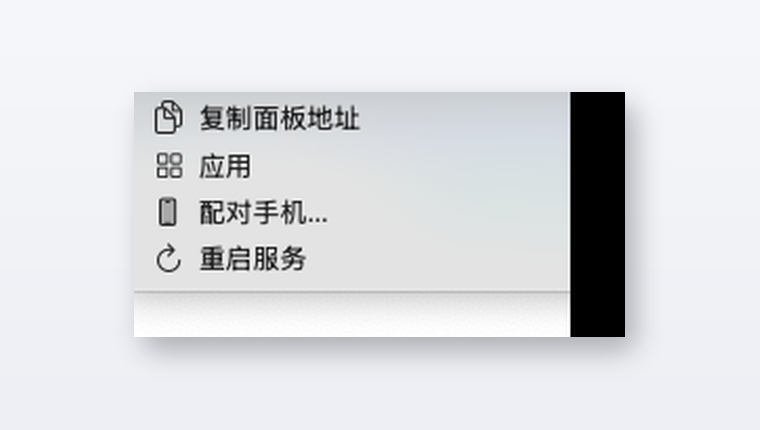

<sub>电脑控制子菜单：面板地址、在浏览器打开面板、应用、快捷操作、配对手机、重启服务。</sub>

## 截图、录屏与视频剪辑

截图/录屏是独立的 Mac 本机模块：不经过手机，也不占用遥控服务。菜单栏「截图与录屏」提供全屏、区域、窗口、滚动截图，以及 MP4 / GIF 录制和截图历史。全局快捷键 **`F1`** 或 `⌘⇧X` 默认**关闭**；到 设置 → 快捷键 打开后，可直接唤起区域截图。

<table>
<tr>
<td width="40%">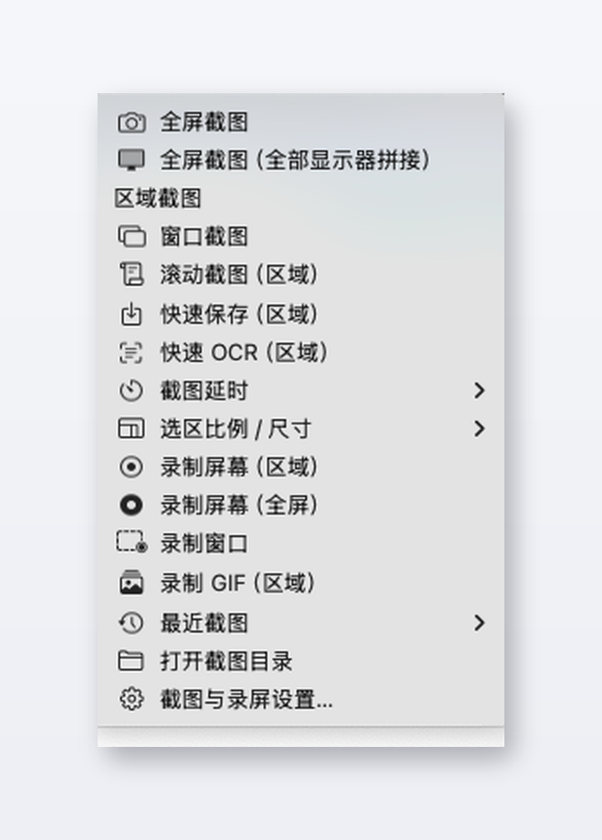</td>
<td width="60%">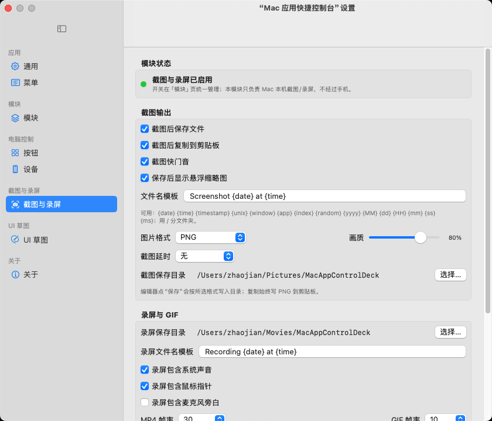</td>
</tr>
<tr>
<td align="center"><sub>菜单栏子菜单：截图、OCR、录屏、GIF、最近截图</sub></td>
<td align="center"><sub>设置页：保存/剪贴板/快门音、命名模板、格式与质量、录屏目录</sub></td>
</tr>
</table>

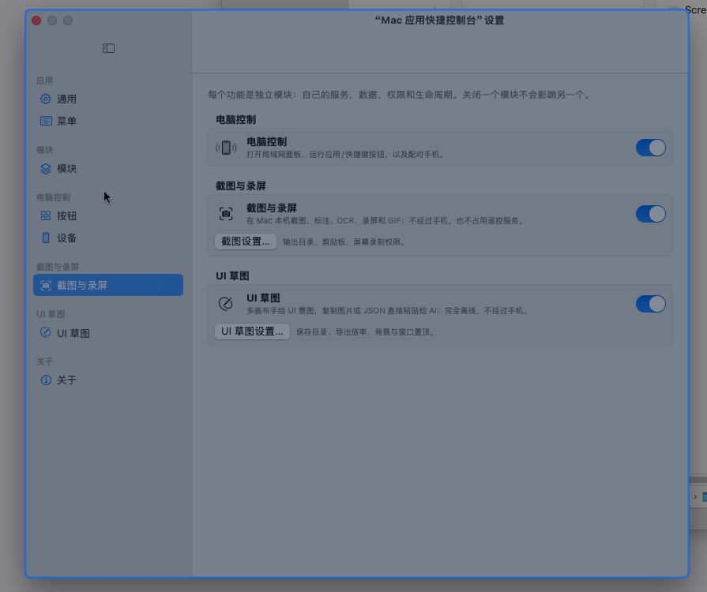

<sub>区域截图：桌面变暗后拖选区域；窗口自动高亮，可按 `F` 切全屏，选好后进入标注编辑器。</sub>

使用方式：

1. **截图**：先在 设置 → 快捷键 打开 `F1` / `⌘⇧X`，之后按快捷键直接进入区域截图；也可菜单栏 → 截图与录屏 → 全屏 / 区域 / 窗口 / 滚动截图。`快速保存（区域）` 直接写文件，`快速 OCR（区域）` 直接识别文字
2. **标注**：截图后进入标注编辑器，可加矩形、椭圆、箭头、画笔、文字、序号、马赛克、模糊、聚光灯、测量与裁剪，再复制或保存
3. **钉图**：编辑器里钉到屏幕，或菜单栏「钉剪贴板内容」，用于对照抄写、比对设计稿
4. **录屏**：录制屏幕（区域 / 全屏）/ 窗口，可选系统声音与麦克风、鼠标指针、15–120 fps；录制时有顶部 HUD 与边框，可随时停止
5. **视频剪辑**：录制完成后可多段剪切、0.5–4× 变速、加字幕、调分轨音量，导出 MP4 或 GIF

默认输出：截图到 `~/Pictures/MacAppControlDeck`，录屏到 `~/Movies/MacAppControlDeck`；均可在设置页修改。

> `F1` 默认不占用。启用后它是全局快捷键，其他应用在前台也能触发。若 Apple 键盘把 F1 用作亮度调节，请在「系统设置 → 键盘」开启「将 F1、F2 等键用作标准功能键」，或按 `fn + F1`。若和其他软件冲突，可在 **设置 → 快捷键** 关闭或改键。

## UI 草图

完全离线的 Excalidraw 画板，用来快速画 UI 线框/流程，再把图片或 JSON 直接粘给 AI。全局快捷键 `⌃⌥D`（默认关闭，可在设置 → 快捷键打开）打开画板。

默认 `resident=false`：启动不加载画板，第一次打开才创建 `SketchRuntime`（窗口、WebView、Store 与画布索引），关闭窗口后整体释放。设置 → UI 草图可开启「常驻内存」，此时关闭窗口只保留轻量控制器与 Store，WebView 仍然销毁；关闭开关且窗口已关闭时立即释放。菜单、快捷键、内置操作与设置页按钮全部走 `SketchModule` 代理。


使用方式：

1. **新建画布**：左上角「画布」下拉新建/重命名/删除，每张画布独立保存内容与视口；`⌘N` 也可新建
2. **手绘**：矩形、椭圆、箭头、文字、便签、自由画笔齐全，支持网格、吸附、图层与透明度
3. **载入素材**：顶部「精选素材」内置 16 组、285 个组件、1531 个元素（Excalidraw 官方素材库，MIT），可搜索、分类载入；也可用原生「素材库」侧栏
4. **交给 AI**：选中后「复制图片」只复制选中对象，不选则复制整板；「复制 JSON」输出带 `isDiagram` / `ai.kind=diagram` 的场景 JSON
5. **保存**：`⌘S` 或「保存」会同时写 PNG 与同名 `.excalidraw` 源文件到 `~/Pictures/MacAppControlDeck/Sketches`
6. **内存**：默认打开才加载、关闭即释放；设置 →「UI 草图 → 常驻内存」开启后，关闭窗口只保留轻量控制器与 Store，WebView 仍销毁


## 万年历

独立日历窗口，参考中文日历的信息密度：公历大数字、农历小字、节气/节日彩色标记、法定节假日 `休/班` 角标，底部是选中日期的干支生肖与宜忌。

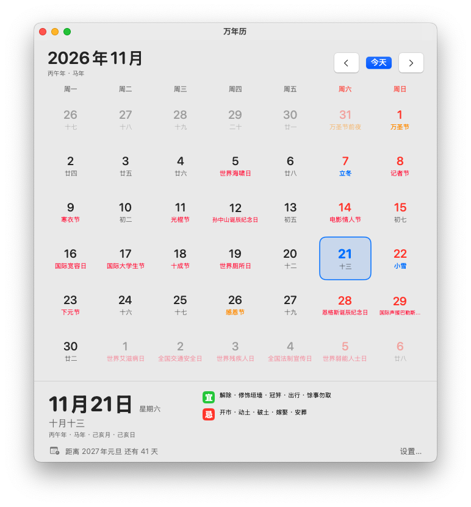

使用方式：

1. **入口**：菜单栏「万年历 → 打开万年历…」，或手机面板/菜单栏快捷操作里的「万年历」按钮
2. **查看**：默认周一开头，可前后翻月、回到今天；点击日期切换底部详情
3. **节假日**：法定休息日显示绿色 `休`，调休上班显示橙色 `班`；底部显示下一个节假日倒计时
4. **内存**：默认「打开才加载，关闭即释放」。设置 →「万年历 → 常驻内存」开启后，关闭窗口仍保留历法数据，再次打开更快；关闭开关且窗口已关闭时立即释放
5. **隐私**：纯本地 LunarSwift 计算，不联网、不读取系统日历/提醒、不申请定位与通讯录权限

<table>
<tr>
<td width="45%">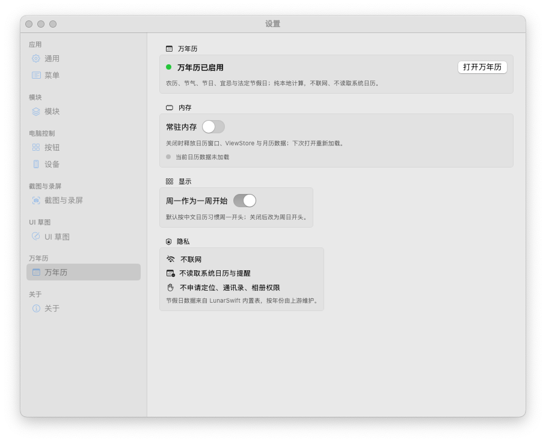</td>
<td width="55%"></td>
</tr>
<tr>
<td align="center"><sub>设置：常驻内存、周一/周日起始、隐私说明</sub></td>
<td align="center"><sub>月历、节气/节日、休/班、宜忌与节假日倒计时</sub></td>
</tr>
</table>

## 桌面宠物

桌宠设置通过 BongoCat / KeyCat 标签切换桌宠，选择会保存。KeyCat 是响应键鼠的黑猫，支持光标跟随、按住头部摸头、拖动和轮廓穿透，沿用桌宠窗口与输入监控；上游未提供项目级许可证，仅声明个人及内部使用，公开分发前需取得授权。详情见 `THIRD_PARTY_NOTICES.md`。

默认桌宠是 BongoCat **standard** 的透明键鼠场景：白猫趴在圆角鼠标垫与完整键盘前，**没有白桌托板、没有第二条桌线**，透明区域直接透出壁纸。窗口无边框、置顶且不抢焦点，按轮廓点击穿透。


- **官方模型**：使用 BongoCat standard Live2D 模型、53 个键位图、表情与动作，统一 612×354 画布，窗口 612:372
- **真实输入**：左爪响应键盘按下/松开与组合键 overlay，右爪响应鼠标左右键；数字小键盘复用主键区素材
- **视线跟随**：光标按屏幕归一化，左上 / 右下对应模型视口方向，按帧阻尼过渡，跨屏直接切换
- **透明背景**：`background.clean.png` 由官方背景派生，只保留鼠标垫与完整键盘，去掉白桌、方形边缘和斜线
- **尺寸与生命周期**：小 / 中 / 大三档，以底部中心为锚点缩放；隐藏即释放窗口、输入监听与动画资源
- **自动避让**：全屏应用、屏幕锁定/休眠、Secure Input、低电量与自带录屏期间自动暂停或隐藏，恢复后继续
- **隐私与降级**：输入监听只读物理按键状态，不记录字符、不联网；没有「输入监控」权限时仍能显示和跟随鼠标
- **入口**：菜单栏「桌面宠物 → 打开桌宠」、`⌃⌥P`（默认关闭），或「设置 → 按钮 → 添加内置操作」添加「打开桌面宠物」后从菜单栏快捷操作与手机面板触发

已知限制：官方键位高亮坐标尚未按新键盘透视逐键重映射，按住字母键时蓝色高亮/猫爪落点可能与画面键帽位置有偏差；模型、键位图与背景来自 BongoCat 上游，按 Apache-2.0 随包保留许可证与来源说明，详见 `THIRD_PARTY_NOTICES.md`。

需求记录：[`fix-keycat-pointer-direction`](openspec/changes/archive/2026-11-23-fix-keycat-pointer-direction/proposal.md) · [`integrate-keycat-desktop-pet`](openspec/changes/archive/2026-11-23-integrate-keycat-desktop-pet/proposal.md) · [`adopt-bongocat-live2d-model`](openspec/changes/archive/2026-11-22-adopt-bongocat-live2d-model/proposal.md) · [`remove-pet-white-desktop`](openspec/changes/archive/2026-11-22-remove-pet-white-desktop/proposal.md) · [能力规格](openspec/specs/pet-live2d-bongocat/spec.md)

## 手机端使用

1. 手机与 Mac 连接同一 Wi-Fi
2. Safari 打开 Mac 端显示的面板地址
3. 点击 Mac 菜单栏「配对手机…」（或设置 → 电脑控制 → 服务 → 生成 6 位配对码），在手机输入 → 配对成功，显示按钮列表
4. （可选）Safari 分享 → 添加到主屏幕，之后像 App 一样全屏使用

点击按钮后的状态行会如实显示结果（`已切换到前台` / `已启动并切到前台` / 具体失败原因）。

面板会按手机方向自动换布局，整页锁定在视口内，只保留横向翻页：

- **竖屏**：应用按钮 **2 列**，按数量动态增加行；底部快捷操作 **4×2**
- **横屏**：左侧竖轨放标题、日期、红色时间、全屏与连接状态；中间应用 **4 列 × 3 行（12 个/页）**，右侧快捷 **2 列 × 4 行（8 个/页）**；「应用」「快捷操作」标题竖排在各区左侧，窄横屏（<700px）自动降为应用 3×4
- **翻页与旋转**：应用页、快捷页各自横向 scroll-snap；底部页点可直接跳到对应页；旋转屏幕后保持当前页索引
- **浏览器全屏**：点击标题栏（横屏为左轨底部）的「⛶」尝试进入全屏，再点「退出」恢复；如果安卓 Alook 未开放网页全屏，请使用浏览器菜单的全屏模式，或将页面添加到主屏幕。快捷操作的图标和名称会根据卡片空间等比缩小。
- **强制刷新**：点右上角「已连接」徽标即可强制刷新面板（带版本与时间戳重载，不受浏览器缓存影响）
- **横屏时钟**：左侧竖轨以鲜艳红显示手机本地时间 `HH:mm:ss`（上方为 `YYYY/MM/DD` 与星期），每秒刷新；竖屏不显示
- **边界**：0 / 1 / 7 / 8 / 12 个快捷操作分别验证隐藏、占位与分页；320×568 到 1440×900 均无页面纵向/横向溢出

<table>
<tr>
<td width="50%" align="center"></td>
<td width="50%" align="center"></td>
</tr>
<tr>
<td align="center"><sub>首次打开：输入 Mac 端生成的 6 位配对码</sub></td>
<td align="center"><sub>竖屏：应用 2 列 + 底部快捷 4×2</sub></td>
</tr>
</table>

<p align="center">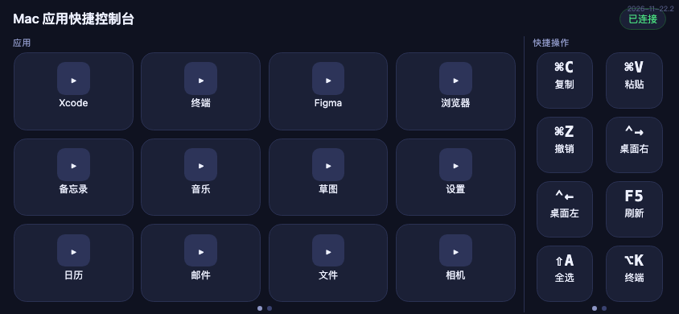<br><sub>横屏：左轨 + 竖排标题 + 应用 4×3（12/页）+ 快捷 2×4（8/页）（844×390 实际面板）</sub></p>

## 手机副屏（时钟 + 月历 + 天气）

把另一台闲置手机/平板当桌面副屏：打开独立地址 `/screen/` 即显示模拟时钟、当月月历与天气。时钟与月历以 **Mac 的日期和时区** 为准，不受手机日期影响；页面**只读、免配对**，不会显示也不会触发任何按钮；天气也由 Mac 端代理，手机拿不到凭据与坐标。

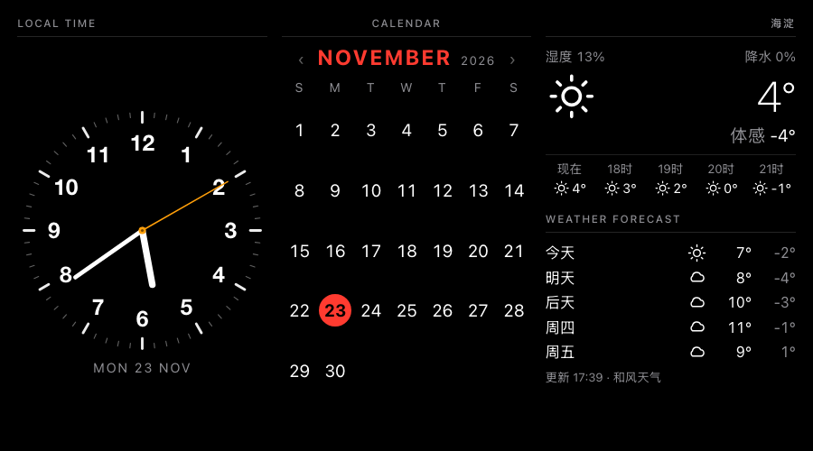

- **地址**：Mac 菜单栏「电脑控制」→「复制副屏地址」（形如 `http://192.168.1.8:47615/screen/`），或设置 → 副屏
- **布局**：横屏为严格等宽的三栏「时钟 | 月历 | 天气」，三栏共用「小标题 + 分隔线」头部节奏；月历独占整列高度，5 行不挤压；天气栏自上而下是「当前 → 现在+4 小时 → 5 天」；竖屏为「时钟 → 天气（含小时条与 5 天预报）→ 月历」；未配置天气时回到「时钟 + 月历」两栏；整页不滚动
- **天气内容**：右对齐城市、湿度与降水概率、单色大图标 + 48px 温度、体感；下方两行紧凑小时条显示「现在 + 4 小时」（时间 / 图标+温度，按 Mac 时区）；再下方「WEATHER FORECAST」四列表格展示 5 天；底部显示更新时间和「和风天气」署名；点按屏幕可唤出「↻」强制刷新
- **三档尺寸**：点按屏幕唤出控制条，选「小 / 中 / 大」，选择会记住；5 秒后控制条自动隐藏
- **状态栏公共层**：模块不再各自创建状态项；PureMac 的 CPU / MEM / 网速各自是**独立状态项**，点哪个弹哪个的菜单（CPU 看占用最高的应用、MEM 看内存排行、网速看 ↑/↓ 速率，含「打开 PureMac…」），模块关闭时自动消失；设置 →「状态栏」统一管理勾选（模块关闭时置灰保留）
- **上班/下班主题**：月历栏底部显示「距下班 04:33:12 / 还剩 72%」，上班前「距上班」、下班后转绿正计时；只有一种布局，放不下时整卡等比缩小（480×320 约 0.70）；左侧 14 个内联动图（工作中 12 个每 5 分钟轮播、每小时错位，剩余 50%/25%/10% 插播对应场景，45 秒一次速度微变化；未上班咖啡、已下班小人各 1 个不轮播）；上班/下班时间在 设置 → 副屏 → 下班倒计时 设置（每天同一套时间，暂不区分工作日与节假日）

- **保持常亮**：浏览器支持 Wake Lock 时自动申请，并在回到前台后重新申请；不支持时如实显示「不可用」
- **月份浏览**：`‹ ›` 查看前后月份，点月份名回到当月；浏览他月 60 秒无操作会自动回到当月
- **内置操作**：从「按钮管理 → 添加内置操作」添加「打开副屏」后，可从菜单栏快捷操作与手机面板快捷操作触发（在 Mac 浏览器打开）

<p align="center">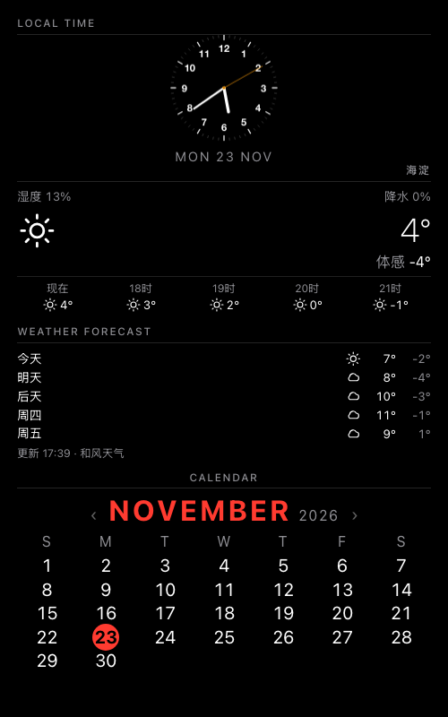<br><sub>竖屏：时钟 → 天气（含 5 天预报）→ 月历（500×800 视口）</sub></p>

### 配置天气（和风天气）

默认用 **API Key**，只需两项：

1. 注册/登录[和风天气控制台](https://console.qweather.com/)，在「设置」里找到 **专属 API Host**（形如 `xxxx.qweatherapi.com`，不要填文档示例），在项目管理里创建一个 **API Key**
2. 打开「设置 → 副屏」，认证方式保持 **API Key**，填好 API Host，粘贴 Key 并点「保存」
3. 在「选择城市」里搜索，或点 **「使用当前位置」** 让 Mac 定位自动填城市（首次会请求定位权限；失败可手动搜索）
4. 保存凭据或选好城市后会自动测试并打开天气开关；也可手动点「测试连接」。副屏会立即刷新，无需等轮询
5. 副屏页面每 30 秒轮询；Mac 端缓存 5 分钟，断网时显示上次结果并标记「已过期」

需要长期稳定或更高额度时可切到 **JWT（Ed25519）**：生成密钥对 → 复制公钥 → 控制台「项目管理 → 添加凭据 → JWT」上传 → 填写开发者 ID（`iss`）、项目 ID（`sub`）、凭据 ID（`kid`）。和风从 2027-01-01 起会限制 API Key 的每日请求量，副屏每天约 288 次请求，个人使用通常足够。

> 和风新版接口必须使用账号专属 Host。API Key 与私钥保存在本机 `weather-secrets.json`（仅当前用户可读，0600），不使用钥匙串、不进日志、不下发手机。从旧版本升级后需要重新粘贴一次 API Key。免费额度与控制台条款以和风账号为准。

## 添加 / 管理按钮（Mac 端）

菜单栏 →「设置…」→「按钮」标签页：

- 「添加按钮」→「添加应用按钮…」搜索选择应用（按 Bundle ID 绑定）；也可添加「快捷操作」或「命令按钮」
- 每行支持「⋯ → 重命名…」、↑↓ 排序、「⋯ → 删除…」（删除有确认）
- 应用被删除/移动后按钮显示「应用缺失」，可回到 App 列表重新绑定
- 「设备」标签页可撤销任意设备的配对（撤销后旧凭证立即失效）

## 设置界面

所有配置集中在「设置…」（`⌘,`）里，左侧按应用、模块与电脑控制分组：

<table>
<tr>
<td width="50%">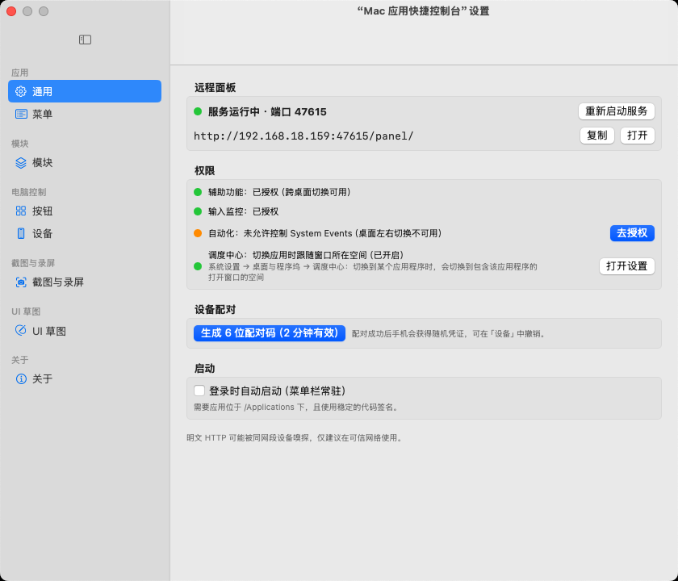</td>
<td width="50%">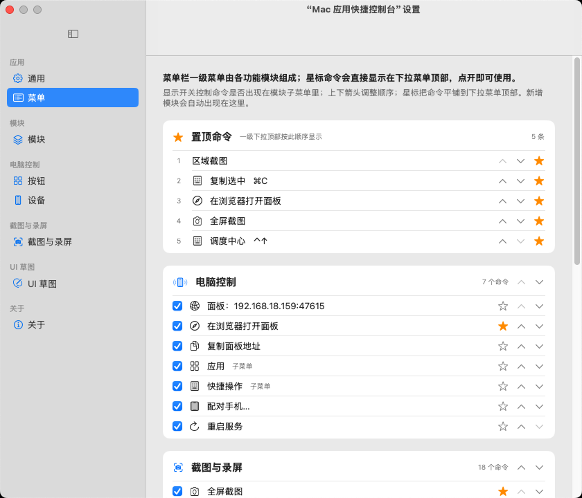</td>
</tr>
<tr>
<td align="center"><sub>通用：登录启动、数据与日志目录</sub></td>
<td align="center"><sub>菜单：置顶命令、各模块命令显隐与上下排序</sub></td>
</tr>
<tr>
<td></td>
<td></td>
</tr>
<tr>
<td align="center"><sub>服务：远程面板、权限状态、配对码</sub></td>
<td align="center"><sub>截图与录屏：保存、格式、延时与录制</sub></td>
</tr>
<tr>
<td></td>
<td>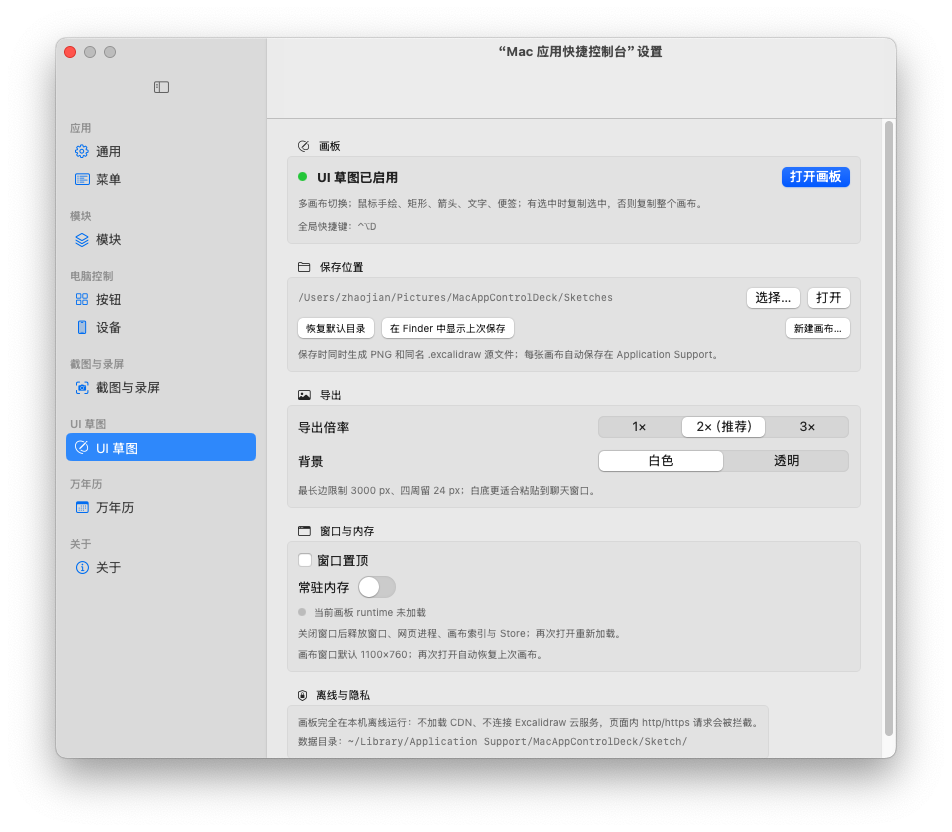</td>
</tr>
<tr>
<td align="center"><sub>模块：独立开关电脑控制、截图录屏、UI 草图与万年历；可选模块支持常驻内存</sub></td>
<td align="center"><sub>UI 草图：打开画板、保存目录、导出倍率与背景、常驻内存</sub></td>
</tr>
<tr>
<td></td>
<td></td>
</tr>
<tr>
<td align="center"><sub>万年历：常驻内存、周一/周日起始、隐私说明</sub></td>
<td></td>
</tr>
<tr>
<td></td>
<td></td>
</tr>
<tr>
<td align="center"><sub>设备：查看已配对设备并随时撤销，旧 token 立即失效</sub></td>
<td></td>
</tr>
</table>

「电脑控制 → 副屏」页集中管理副屏地址与天气：天气开关、和风 API Host、认证方式（API Key 默认 / JWT 可选）、API Key、JWT 的 `iss` / `sub` / `kid` 与公钥、城市搜索、测试连接。API Key 与私钥存本机 0600 凭据文件。

「快捷键」页管理系统级快捷键：顶部一个总开关，下面每个入口一行，可单独开关、点「修改」录制新组合、点「全部恢复默认」还原组合并关闭。首次安装与恢复默认后所有快捷键都是关闭的，不会抢任何按键。被其他软件占用的组合会显示「被其他应用占用」并每 2 秒重试；录制期间其他快捷键临时暂停，避免吞掉要录的按键。配置保存在 `hotkeys.json`，重建或重装后保留。

## 激活策略（简述）

点击按钮后的执行顺序：

1. **应用未运行** → `openApplication` 启动 → 等进程出现 → 进入激活流水线
2. **已运行** → 按优先级尝试：
   - **Dock 图标 AXPress**（辅助功能）：由 Dock 进程执行激活，等价真人点击，跨空间原生生效
   - **AXRaise 目标窗口**：应用不在 Dock 时使用，会顺带取消最小化
   - **`activate(from:)` / LSOpen**：公开 API 兜底
3. **成功判定**：目标应用是否成为前台应用。窗口可见性只记诊断日志——进程内 `CGWindowList` 数据在真机上与其他进程不一致，不可作为判定依据

详细原理、实测记录与取舍见 `openspec/changes/archive/2026-11-19-add-core-control-loop/design.md`。

## 安全边界（务必阅读）

- 手机只能执行白名单动作：列出按钮、激活某个已配置按钮；**不能**执行任意 shell / 任意应用
- 所有接口要求配对换发的随机 token（配对码 2 分钟有效、错 3 次作废）
- 通信为**明文 HTTP**：同网段设备理论上可嗅探到 token/配对码，请仅在可信家庭局域网使用；HTTPS 为后续评估项
- 程序不修改系统设置、不默认开机自启；电脑遥控使用可选的辅助功能授权，截图/录屏使用屏幕录制授权（仅在使用 capture 模块时申请），两者互不影响
- 数据存放在 `~/Library/Application Support/MacAppControlDeck/`（`buttons.json` / `devices.json` / `hotkeys.json` / `icons/`），程序重启后保留

## 快捷操作与命令按钮

「快捷操作」分组支持两类按钮，另有「内置操作」可直接添加：

- **按键组合**：预设（桌面左/右、⌘C、⌘V、⌘A、⌘Z、回车、Esc、F1–F12）或自定义录制/拼凑。适用于普通应用（编辑、IDE 等）。
- **命令按钮**：执行某个应用内置的命令行（例如 Snipaste 的 `snip`），参数只在 Mac 端配置，手机端仍只发送按钮 ID。
- **内置操作**：在「设置 → 按钮 → 添加内置操作」中添加，包括「打开设置」「打开快捷键设置」「截图」「打开 UI 草图」「打开万年历」「打开副屏」「打开桌面宠物」。

> **已知限制**：Snipaste 等注册系统级热键的应用会忽略注入的按键（F1 对其无效，已实测输入监控授权也不能解决），因此这类应用请用**命令按钮**方式触发（例：应用选 Snipaste、参数 `snip`）。

**连续点击**：每个按钮有独立队列（上限 8 条），点击立即入队、按顺序执行、不阻塞后续点击；系统会按操作类型设置超时（快捷操作 2.5s、命令 4s、应用 20s），超时的命令自动放弃并继续执行队列，无需等待提示消失。

## 测试

```zsh
swift test --filter PanelLayoutTests    # 只跑受影响的用例（默认做法）
swift test                              # 全量 142 项；发版前或跨模块改动才跑，默认跳过 4 个真实激活用例
DECK_RUN_ACTIVATION_E2E=1 swift test    # 需要回归打开应用时显式启用
```

桌宠回归覆盖窗口尺寸、设置持久化、KeyCat 的 WebKit 渲染与输入，以及两套模型的窗口切换。

「打开应用」的启动/激活流水线已稳定，日常回归不再重复手工验证；只有改动 `AppControl`、激活接口、按钮配置或权限/签名时才需要回归。详见 `AGENTS.md` 的 R3。

自动化测试只跑受影响功能，不做全量回归（改面板就 `--filter PanelLayoutTests`，改桌宠就 `--filter Pet`）；全量只在跨模块改动或发版前跑。详见 `AGENTS.md` 的 R4。

## 已知限制

- 最小化窗口的恢复由系统/应用决定；无法确认时如实反馈，不谎报
- 无可见窗口的应用（菜单栏类）激活后不新建窗口（依应用自身行为）
- 没有 Dock 图标的应用无法使用 Dock 点击路径，跨空间能力受限
- iOS 主屏幕 Web App 与 Safari 的 localStorage 互相独立，两端需分别配对一次
- Mac IP 变化后需重新扫码打开新地址（可能需重新配对）
- Mac 休眠/锁屏/退出后不可用，手机会显示「Mac 未连接」（属设计行为）
- 滚动截图是自动向下滚动 + 重叠拼接；如果选区包含固定侧栏/固定工具栏，长图里会重复出现这些固定区域，建议只框选可滚动内容
- 手机面板只支持横向翻页，不做纵向滚动；横屏应用固定 12 个/页（窄横屏 3×4）、快捷固定 8 个/页；极窄横屏（≤640px，例如 480×320）左侧竖轨收窄到 70px、时间字号下调，优先保证应用与快捷按钮可用
- 副屏时钟与月历以 Mac 时间为准；`/api/time` 不可达时退回手机本地时间，此时仍可能与 Mac 不一致
- iOS 省电模式或锁屏会挂起页面，Wake Lock 不保证常亮
- 副屏天气依赖和风账号与 Mac 出网；和风 v1 的 JSON 字段未在文档中给全，首次接入需要用「测试连接」校准解析
- 「使用当前位置」依赖 macOS 定位权限与 Wi-Fi；没有定位权限或定位失败时仍可手动搜索城市
- 天气是 10 分钟级缓存，不是秒级实时；和风控制台删除凭据或公钥后，需要重新生成密钥对并上传
- BongoCat 键位高亮尚未逐键重映射到新键盘透视；按住字母键时蓝色高亮/猫爪落点可能偏离画面键帽
- 上传（Google Drive / imgbb / S3）、翻译、Sparkle 自动更新、账号体系不移植；详细对照见 [Docs/architecture/MACSHOT_PORT.md](Docs/architecture/MACSHOT_PORT.md)

## 故障排查

| 现象 | 处理 |
| --- | --- |
| 手机显示「Mac 未连接」 | 确认 Wi-Fi 同网段、Mac 端 App 正在运行；Mac 休眠会断开 |
| 面板要求重新配对 | 凭证失效或被撤销，在 Mac 端重新生成配对码 |
| 按钮显示「应用缺失」 | 应用已卸载/移动，在 Mac 端重新绑定 |
| 端口冲突 | 服务自动尝试 47615–47634，以窗口显示地址为准 |
| 点击无反应 | 看按钮下状态行：失败原因会原样显示（如「启动失败：…」） |
| 面板地址是 169.254.x.x、手机访问不到 | 该地址属于未联网的网卡（常见于有线口 en0 没插网线、Wi-Fi 实际是 en1）。本版已改为「可路由地址优先」，若仍显示 169.254 请检查网络连接 |
| Android Chrome 一直转圈/提示无法连接 | 浏览器把 `http://` 强制升级成 HTTPS，而服务只支持明文 HTTP。完整输入 `http://IP:端口/panel/`，关闭 Chrome「始终使用安全连接」（或 `chrome://flags/#https-upgrades` 设为 Disabled），也可改用 Firefox |
| 配对提示成功但仍停在配对页 | 旧版在「按钮数为 0」时会退回配对页；本版已修复为进入主界面并显示空状态，按提示在 Mac 端添加按钮即可（面板 5 秒自动刷新） |
| 点击后只切菜单栏、不跳桌面 | ①检查调度中心开关（见上）；②检查辅助功能状态灯是否绿色。手动点 Dock 图标也不跳桌面即为开关问题 |
| 辅助功能状态灯一直橙色 | 先执行 `./Build/verify-signing.sh /Applications/MacAppControlDeck.app`；若显示 ad-hoc/纯 cdhash，说明装错了包（多为 v0.2.0 及更早的 ad-hoc release）；换回 v0.3.0+ 的固定签名包 `./Build/build.sh`。若签名正常，删除系统设置里的旧条目，重新添加当前 App，再重启程序 |
| 已授权屏幕录制却仍提示授权 | 先确认当前 App 不是 ad-hoc：`./Build/verify-signing.sh`。固定签名包的 designated requirement 应包含 `certificate root = H"e83574620fe6cf96ba5a9c902f8b6a5c38f5a6b3"`；若仍是纯 cdhash，重新执行 `./Build/build.sh` 并覆盖安装，再授权一次 |
| F1 触发不了 Snipaste 等全局热键应用 | 已知限制：请改用「命令按钮」（应用选 Snipaste、参数 `snip`）。普通应用中 F1 可正常注入 |
| F1 不打开区域截图 | ①先在 设置 → 快捷键 打开 F1（默认全部关闭）；②Apple 键盘把 F1 当亮度键：开启「将 F1、F2 等键用作标准功能键」或按 `fn + F1`；③F1 被其他程序占用：设置 → 快捷键 会显示「被其他应用占用」并每 2 秒重试，也可改键，期间用 `⌘⇧X` |
| 手机端 F1 按钮没有发到目标应用 | 已知限制：若开启了 Deck 的全局 F1，应用运行期间它会优先打开区域截图。需要向目标应用发送 F1 时，先关闭 Deck 的全局 F1 或改用命令按钮 |
| 点击启动台/系统界面后显示"未确认" | 启动台等系统界面不会以常规应用注册进程，属正常；已打开即可用 |
| 快捷键提示"当前处于安全输入状态" | 密码框/锁屏等安全输入场景会屏蔽按键注入，退出安全输入后重试 |
| 桌面左/右切换无反应 | 检查「自动化」权限：系统设置 → 隐私与安全性 → 自动化 → 勾选 MacAppControlDeck → System Events；并确认系统键盘快捷键「向左/向右切换桌面」为默认的 ⌃←/⌃→ |
| 重新构建后授权失效 | 执行 `./Build/verify-signing.sh /Applications/MacAppControlDeck.app`。若输出 ad-hoc/纯 cdhash，说明装的是旧版 ad-hoc release：改用 v0.3.0+ 的固定签名包并覆盖安装，再授权一次。正常固定签名包的 DR 包含 `certificate root = H"e835..."`，后续重建不需要重新授权 |

运行日志：`~/Library/Application Support/MacAppControlDeck/logs/activation.log`（含每条激活策略的执行结果）。

## 项目结构

```
Sources/MacAppControlDeck/
├── App/DeckApp.swift            # 入口：菜单栏应用（无主窗口）
├── App/DeckState.swift          # remote 模块运行状态（服务/权限/配对/按钮/设备）
├── Core/                        # 模块协议、注册表、菜单/设置壳（不放业务逻辑）
├── Modules/
│   ├── RemoteControl/           # 电脑遥控模块：HTTP 服务/配对/手机面板/按钮
│   ├── Capture/                 # 截图与录屏模块：Mac 本机使用，不接 HTTP
│   ├── Sketch/                  # UI 草图模块：轻量代理 + 按需 runtime，关闭窗口释放
│   ├── Calendar/                # 万年历模块：轻量代理 + 按需 runtime，关闭窗口释放
│   └── Pet/                     # 桌面宠物模块：透明 NSPanel + BongoCat standard Live2D + CGEventTap + 按需 runtime
├── Updater/                     # 自动升级：Sparkle 2 封装、feed 覆盖、状态持久化
├── Control/AppControl.swift     # 激活流水线（Dock AXPress / AXRaise / 兜底）
├── Control/QuickActionRunner.swift # 菜单栏按钮执行器（与 HTTP 接口同源）
├── Server/                      # remote 模块：NWListener HTTP 服务、路由
├── Store/                       # remote 模块：配置持久化、配对管理
├── UI/MenuBarController.swift   # NSStatusItem + NSMenu（按模块拼接菜单）
├── UI/SettingsView.swift        # 统一设置壳：按模块分区
├── UI/ButtonsSettingsView.swift # remote 模块：按钮管理
└── Panel/PanelHTML.swift        # remote 模块：手机端单页 Web 面板
Sources/MacShotKit/              # macshot 上游功能代码，只允许 capture 模块 import
Web/sketch/                      # UI 草图 Web 包装层源码（Vite + React + Excalidraw）
Build/
├── build.sh                     # 构建/签名/打包（含图标），产出到 BuildOutput/
├── package-release.sh           # 按 arm64 / x86_64 生成可分发 DMG + ZIP
├── signing.sh                   # 固定签名身份、签名与 DR 校验
├── verify-signing.sh            # 检查构建产物/已安装 App 是否仍是稳定签名
├── setup-signing.sh             # 一次性创建稳定自签名证书
├── make-icon.swift              # 生成 AppIcon.iconset
└── Info.plist                   # Bundle 元数据（含 Automation 用途说明）
BuildOutput/                     # 构建产物（.gitignore）
Docs/images/readme/             # README 功能截图（菜单栏、设置页、手机面板、UI 草图、桌面宠物）
Docs/architecture/MODULES.md     # 【强制】模块边界与隔离规则
Docs/architecture/UPSTREAM_PORTING.md # 上游开源集成方法、验收标准与踩坑记录
Docs/archive/                    # 历史归档
```

> 模块边界是硬约束：`remote`、`capture`、`sketch`、`calendar` 与 `pet` 各自拥有服务、数据、权限和生命周期，互不引用、互不混排。详见 [Docs/architecture/MODULES.md](Docs/architecture/MODULES.md)。

## 归档

- 2026-11-26 XP-Pen Deco 640 自定义手写板驱动预研（非需求，未建 OpenSpec 变更）：用户态 `IOHIDManager` 方案、三条 HID 通道、私有 12 字节报文与初始化序列、8+2 可配置按键、等比例画布限制与鼠标光标仲裁、只读映射到完整接管的分阶段路线：[预研报告](Docs/research/2026-11-26-deco640-driver-research.md) · [HID 探针](Tools/DecoProbe.swift)
- 2026-11-26 移除按钮管理底部选中操作条：点击卡片仅高亮选中，不再弹出「已选 xxx / 重命名 / 删除」底栏，重命名、删除、编辑组合、上移、下移统一走右键菜单：[OpenSpec 变更](openspec/changes/archive/2026-11-26-remove-buttons-grid-selection-bar/proposal.md) · [能力规格](openspec/specs/button-panel-config/spec.md)
- 2026-11-26 按钮管理改为 4 列卡片网格：点击选中、底部操作条、右键重命名/上移/下移/删除；长按 0.5 秒进入拖动准备态，拖动期间只本地预览、松手一次落盘，组内排序并同步菜单栏与手机面板：[OpenSpec 变更](openspec/changes/archive/2026-11-26-add-buttons-grid-longpress-reorder/proposal.md) · [设计](openspec/changes/archive/2026-11-26-add-buttons-grid-longpress-reorder/design.md) · [能力规格](openspec/specs/button-panel-config/spec.md)
- 2026-11-26 副屏控制条改到顶部显示，显示后 5 秒自动隐藏（含触屏），点屏幕任意处可再次唤出，不再常驻挡屏：[OpenSpec 变更](openspec/changes/archive/2026-11-26-screen-chrome-top-auto-hide/proposal.md) · [能力规格](openspec/specs/remote-web-panel/spec.md)
- 2026-11-25 区域截图钉图落在原截图位置：接通 `PinSource`，有来源强制原位（大图围绕选区中心缩放、跨屏保持原尺寸、来源屏缺失回退居中），无来源（历史/剪贴板/缩略图/编辑器）仍居中：[OpenSpec 变更](openspec/changes/archive/2026-11-25-pin-at-capture-location/proposal.md) · [能力规格](openspec/specs/capture-overlay-parity/spec.md)
- 2026-11-25 去掉桌宠卡片内层背景与内层边框，只保留 `.pet-dock` 一层外框，消除「两个边框」：[OpenSpec 变更](openspec/changes/archive/2026-11-25-remove-pet-inner-background/proposal.md) · [能力规格](openspec/specs/remote-web-panel/spec.md) · [验收截图](Docs/verification/screen-pet/screen-pet-no-bg.png)
- 2026-11-25 副屏刷新真正生效：点「↻」执行整页重载；Mac 端设置变更约 1 秒内触发一次整页重载并带 `rev` 基线防循环：[OpenSpec 变更](openspec/changes/archive/2026-11-25-screen-real-reload/proposal.md) · [能力规格](openspec/specs/remote-web-panel/spec.md)
- 2026-11-25 副屏底栏卡片等高对齐：桌宠框与倒计时卡片撑满同一 120px 底栏、顶边底边齐平，主区与底栏间留统一间距且主区 `flex:1` 填满剩余高度：[OpenSpec 变更](openspec/changes/archive/2026-11-25-align-screen-dock-cards/proposal.md) · [能力规格](openspec/specs/remote-web-panel/spec.md) · [验收截图](Docs/verification/screen-pet/screen-layout-aligned.png)
- 2026-11-25 副屏设置统一到 Mac 端：控制条只保留强制刷新与全屏；尺寸 / 桌宠 / 常亮改在「设置 → 副屏」配置并经 `/api/screen/display` 下发；副屏 HTML 抽为资源文件，改页面从 6.5 分钟降到约 4 秒：[OpenSpec 变更](openspec/changes/archive/2026-11-25-centralize-screen-settings/proposal.md) · [设计](openspec/changes/archive/2026-11-25-centralize-screen-settings/design.md) · [能力规格](openspec/specs/remote-web-panel/spec.md) · [验收截图](Docs/verification/screen-pet/screen-controlbar-final.png)
- 2026-11-25 副屏三栏改为竖向撑满 + 固定底栏（桌宠框 / 下班倒计时 / 天气信息同高同基线），移除顶部标题并把城市名下移；桌宠支持像素猫/小狗/机器人本地换宠、固定或随机切换，修复刷新按钮并显示「已刷新」：[OpenSpec 变更](openspec/changes/archive/2026-11-25-refine-screen-pet-and-layout/proposal.md) · [设计](openspec/changes/archive/2026-11-25-refine-screen-pet-and-layout/design.md) · [能力规格](openspec/specs/remote-web-panel/spec.md) · [验收截图](Docs/verification/screen-pet/)
- 2026-11-25 状态栏新增日历图标项，点击弹深色玻璃月历面板（周日首列 / 农历节气 / 今日蓝框 / 节日休班标记，不读 EventKit）：[OpenSpec 变更](openspec/changes/archive/2026-11-25-add-menubar-calendar-popover/proposal.md) · [设计](openspec/changes/archive/2026-11-25-add-menubar-calendar-popover/design.md) · [能力规格](openspec/specs/status-bar/spec.md) · [开源调研](Docs/research/2026-11-25-menubar-calendar-ui-research.md)
- 2026-11-25 **本机设为正式发版机**（`publish-local.sh` 一键发布、EdDSA 私钥固化到本机、CI 幂等兜底、签名指纹同步为 `E8357462…`）：[本机发布手册](Docs/releases/local-publish.md) · [OpenSpec 变更](openspec/changes/archive/2026-11-25-make-local-machine-primary-release-publisher/proposal.md) · [能力规格](openspec/specs/local-release-publishing/spec.md)
- 2026-11-25 修复 UI 草图资源缺失与阻塞式提示（资源定位兼容 SwiftPM `Contents/Resources/<bundle>/Sketch`；提示改非模态浮动窗，显示时不再阻塞菜单栏与 F1 截图）：[OpenSpec 变更](openspec/changes/archive/2026-11-25-fix-sketch-resource-and-blocking-alert/proposal.md) · [能力规格](openspec/specs/sketch-lazy-runtime/spec.md)
- 2026-11-25 状态栏条目拆成独立状态项（CPU / MEM / 网速各自一条，点击各弹自己的菜单；去掉分段命中，位置各自 ⌘-拖持久）：[OpenSpec 变更](openspec/changes/archive/2026-11-25-split-statusbar-items/proposal.md) · [设计](openspec/changes/archive/2026-11-25-split-statusbar-items/design.md) · [能力规格](openspec/specs/status-bar/spec.md)
- 2026-11-24 **v0.4.1 发布**（自动升级 universal 单包 + PureMac 柠檬式 UI v3 + 菜单栏三状态项 + 实时网速 + MEM 内存占用菜单）：[发布说明](Docs/releases/v0.4.1.md) · [能力规格](openspec/specs/system-cleaner/spec.md)
- 2026-11-24 PureMac 菜单栏拆成 CPU/MEM/网速三个独立状态项、新增实时网速（getifaddrs 差分采样、定宽不抖、上下同色同字号、零 TCC 权限）：[OpenSpec 变更](openspec/changes/archive/2026-11-24-add-menubar-netspeed/proposal.md) · [能力规格](openspec/specs/system-cleaner/spec.md) · [柠檬网速调研](Docs/research/2026-11-24-lemon-netspeed-research.md)
- 2026-11-24 MEM 状态项点击弹出柠檬式内存占用菜单（即时采样、按内存降序、应用行一键正常退出、系统进程禁用）：[OpenSpec 变更](openspec/changes/archive/2026-11-24-add-menubar-memory-menu/proposal.md) · [能力规格](openspec/specs/system-cleaner/spec.md)
- 2026-11-24 PureMac UI 按柠檬交互重做（顶部页签 v3：统一入口卡/路径进度扫描态/分组折叠/分类 tab/状态胶囊，取消走二次确认）+ 修复菜单入口与状态栏数字被裁：[OpenSpec 变更](openspec/changes/archive/2026-11-24-add-puremac-ui-redesign-and-lemon-research/proposal.md) · [能力规格](openspec/specs/system-cleaner/spec.md) · [UI 设计](Docs/plans/2026-11-24-puremac-ui-redesign.md) · [柠檬调研](Docs/research/2026-11-24-tencent-lemon.md)

- 2026-11-24 副屏倒计时改单一布局 + 剩余语义 + 14 个动图轮播（二分等比缩放、`还剩 xx%`、5 分钟轮播与里程碑插播、400ms 交叉淡入）：[OpenSpec 变更](openspec/changes/archive/2026-11-24-refine-screen-countdown-ui/proposal.md) · [能力规格](openspec/specs/remote-web-panel/spec.md) · [验收截图](Docs/verification/screen-countdown/)

- 2026-11-24 副屏月历底部新增每天下班倒计时（上班/下班时间可配、带秒、三态与动效、四档自适应；状态由 Swift 计算，页面只倒数）：[OpenSpec 变更](openspec/changes/archive/2026-11-24-add-screen-offwork-countdown/proposal.md) · [能力规格](openspec/specs/remote-web-panel/spec.md) · [验收截图](Docs/verification/screen-countdown/)

- 2026-11-24 自动升级（Sparkle 2 + EdDSA 校验、universal 单包、GitHub Actions 发版与 appcast；菜单栏/设置/内置操作三处入口）：[OpenSpec 变更](openspec/changes/archive/2026-11-24-add-github-auto-update/proposal.md) · [能力规格](openspec/specs/app-auto-update/spec.md) · [签名规格](openspec/specs/stable-code-signing/spec.md) · [发布说明](Docs/releases/v0.4.0.md)

- 2026-11-24 手机面板应用与快捷按钮统一字号（快捷字号改为与应用同基准、自适应只缩小不放大，消除「老年人模式」观感；面板版本 `2026-11-24.1`，新增三视口回归）：[OpenSpec 变更](openspec/changes/archive/2026-11-24-unify-panel-button-typography/proposal.md) · [能力规格](openspec/specs/remote-web-panel/spec.md) · [验证截图](Docs/verification/panel-button-typography/)
- 2026-11-24 修复桌宠快捷栏运行圆点被裁切（垂直内边距改为撑满条高、上下 8pt，条高=图标+16）：[OpenSpec 变更](openspec/changes/archive/2026-11-24-fix-pet-dock-dot-clipping/proposal.md) · [设计](openspec/changes/archive/2026-11-24-fix-pet-dock-dot-clipping/design.md) · [能力规格](openspec/specs/desktop-pet/spec.md)
- 2026-11-24 桌宠底部快捷栏（单行胶囊 + 长按拖动滚动 + 点击频率排序，条宽随图标数量收缩并居中，去掉单格底框）：[OpenSpec 变更](openspec/changes/archive/2026-11-24-add-pet-dock/proposal.md) · [设计](openspec/changes/archive/2026-11-24-add-pet-dock/design.md) · [能力规格](openspec/specs/desktop-pet/spec.md)
- 2026-11-23 副屏新增未来 4 小时预报（和风 hourly 接口、5 分钟缓存、两行紧凑条；矮屏/竖屏压缩保证月历不溢出）：[OpenSpec 变更](openspec/changes/archive/2026-11-23-add-hourly-weather-strip/proposal.md) · [能力规格](openspec/specs/remote-web-panel/spec.md)
- 2026-11-23 副屏改 MagicMirror 风格三栏（严格 1:1:1、统一小标题/分隔线，天气栏城市+湿度降水+大图标温度+体感+5 天四列表格，竖屏顺序调整）：[OpenSpec 变更](openspec/changes/archive/2026-11-23-refresh-screen-weather-ui/proposal.md) · [能力规格](openspec/specs/remote-web-panel/spec.md)
- 2026-11-23 全局快捷键改为默认关闭（首次安装/恢复默认全部不占用按键，旧配置一次性迁移为关闭；按需在 设置 → 快捷键 打开）：[OpenSpec 变更](openspec/changes/archive/2026-11-23-default-disable-global-hotkeys/proposal.md) · [能力规格](openspec/specs/global-hotkeys/spec.md)
- 2026-11-23 全局快捷键可开关/改键/重置（设置 → 快捷键，总开关 + 单项开关 + 录制 + 恢复默认，冲突可视，`hotkeys.json` 持久化）：[OpenSpec 变更](openspec/changes/archive/2026-11-23-add-configurable-global-hotkeys/proposal.md) · [能力规格](openspec/specs/global-hotkeys/spec.md)
- 2026-11-23 横屏副屏改为三栏（时钟 | 月历 | 天气），月历不再被挤扁，3 天预报补上天气文字；竖屏开天气时时钟收窄到 40%：[OpenSpec 变更](openspec/changes/archive/2026-11-23-fix-screen-landscape-layout/proposal.md) · [能力规格](openspec/specs/remote-web-panel/spec.md)
- 2026-11-23 修正和风 v1 日预报字段（`days` / `daytime.condition.code` / `temperatureMax.value`，3 天图标不再全是云）：[OpenSpec 变更](openspec/changes/archive/2026-11-23-fix-weather-daily-v1-fields/proposal.md) · [能力规格](openspec/specs/remote-web-panel/spec.md)
- 2026-11-23 测试连接后副屏即时刷新（`/api/screen/events` 长轮询，设置变更主动通知页面）：[OpenSpec 变更](openspec/changes/archive/2026-11-23-add-screen-event-push/proposal.md) · [能力规格](openspec/specs/remote-web-panel/spec.md)
- 2026-11-23 副屏设置后更快生效（页面轮询 30 秒、时间同步 60 秒、保存/选城市自动测试并开天气）：[OpenSpec 变更](openspec/changes/archive/2026-11-23-speed-up-screen-refresh/proposal.md) · [能力规格](openspec/specs/remote-web-panel/spec.md)
- 2026-11-23 天气凭据迁移到本地 0600 文件（不再使用钥匙串，彻底去掉登录密码弹窗；升级后需重贴一次 Key）：[OpenSpec 变更](openspec/changes/archive/2026-11-23-move-weather-secrets-to-file/proposal.md) · [能力规格](openspec/specs/remote-web-panel/spec.md)
- 2026-11-23 减少天气凭据的钥匙串弹窗（进程内缓存、只读当前认证方式，提示「始终允许」）：[OpenSpec 变更](openspec/changes/archive/2026-11-23-cache-weather-keychain-reads/proposal.md) · [能力规格](openspec/specs/remote-web-panel/spec.md)
- 2026-11-23 新增「打开设置」内置快捷操作（`settings.open`，升级后自动补一次，也可从按钮管理添加；菜单栏与手机面板可触发）：[OpenSpec 变更](openspec/changes/archive/2026-11-23-add-open-settings-quick-action/proposal.md) · [能力规格](openspec/specs/remote-key-actions/spec.md)
- 2026-11-23 副屏实时刷新修正（`/api/time` 带版本自检、控制条「↻」手动刷新、天气改为 5 分钟并回前台立即刷新）：[OpenSpec 变更](openspec/changes/archive/2026-11-23-fix-screen-live-updates/proposal.md) · [能力规格](openspec/specs/remote-web-panel/spec.md)
- 2026-11-23 副屏天气支持「使用当前位置」（macOS 定位 → 和风反查城市，失败回退搜索）：[OpenSpec 变更](openspec/changes/archive/2026-11-23-add-screen-weather-location/proposal.md) · [能力规格](openspec/specs/remote-web-panel/spec.md)
- 2026-11-23 简化副屏天气配置（三步卡片、示例 Host 拦截、DNS 错误翻译、测试成功自动开天气）：[OpenSpec 变更](openspec/changes/archive/2026-11-23-simplify-screen-weather-setup/proposal.md) · [能力规格](openspec/specs/remote-web-panel/spec.md)
- 2026-11-23 副屏时钟与月历对齐 Mac（`/api/time` + Mac 墙钟，手机日期/时区不再影响「今天」，失败回退手机时间）：[OpenSpec 变更](openspec/changes/archive/2026-11-23-align-screen-clock-to-mac-time/proposal.md) · [能力规格](openspec/specs/remote-web-panel/spec.md)
- 2026-11-23 天气认证改为默认 API Key（JWT 保留为高级选项；API Key 与私钥都存 macOS 钥匙串）：[OpenSpec 变更](openspec/changes/archive/2026-11-23-add-weather-apikey-auth/proposal.md) · [能力规格](openspec/specs/remote-web-panel/spec.md)
- 2026-11-23 副屏天气（和风天气 Ed25519 JWT、实时 + 3 天预报、横屏 L2 / 竖屏 P1 布局、城市搜索与测试连接）：[OpenSpec 变更](openspec/changes/archive/2026-11-23-add-screen-weather/proposal.md) · [能力规格](openspec/specs/remote-web-panel/spec.md)
- 2026-11-23 手机副屏：`/screen/` 只读模拟时钟 + 月历，免配对、三档尺寸、屏幕常亮，Mac 端菜单/设置/内置操作均可取地址：[OpenSpec 变更](openspec/changes/archive/2026-11-23-add-secondary-screen-page/proposal.md) · [能力规格](openspec/specs/remote-web-panel/spec.md)
- 2026-11-23 面板横屏改为左轨 + 竖排标题 + 12 应用 / 8 快捷（面板版本 `2026-11-23.6`）：[OpenSpec 变更](openspec/changes/archive/2026-11-23-refresh-panel-landscape-rail/proposal.md) · [能力规格](openspec/specs/remote-web-panel/spec.md)
- 2026-11-23 手机控制台安卓横屏全屏入口与快捷按钮文字自适应：[OpenSpec 变更](openspec/changes/archive/2026-11-23-fix-android-panel-layout/proposal.md) · [能力规格](openspec/specs/remote-web-panel/spec.md)
- 2026-11-23 点击「已连接」强制刷新面板（`/panel/?v=…&t=…` 重载，面板版本 `2026-11-23.3`）：[OpenSpec 变更](openspec/changes/archive/2026-11-23-add-panel-force-refresh/proposal.md) · [能力规格](openspec/specs/remote-web-panel/spec.md)
- 2026-11-23 横屏时钟改为鲜艳红色（`#ff3b30`、加粗、柔光，面板版本 `2026-11-23.2`）：[OpenSpec 变更](openspec/changes/archive/2026-11-23-tint-panel-clock-red/proposal.md) · [能力规格](openspec/specs/remote-web-panel/spec.md)
- 2026-11-23 重装、面板横屏时钟与傻瓜安装包（签名身份恢复为当时的 `145AEA72…`，现已变更为 `E8357462…`、横屏时钟、双击安装脚本、`macappcontroldeck://` 深链接、聊天传输 ZIP）：[实施记录](Docs/archive/2026-11-23-friendly-install-and-panel-clock/SUMMARY.md) · [OpenSpec 变更](openspec/changes/archive/2026-11-23-refresh-signing-fingerprint-docs/proposal.md)
- 2026-11-23 聊天软件传输用安装包（ZIP 内含 App + 安装脚本 + 说明，解压双击即可装）：[OpenSpec 变更](openspec/changes/archive/2026-11-23-add-chat-transfer-bundle/proposal.md) · [能力规格](openspec/specs/release-installer/spec.md)
- 2026-11-23 设置页深链接与安装后直达桌宠设置（`macappcontroldeck://settings/pet`，未预期失败也弹窗）：[OpenSpec 变更](openspec/changes/archive/2026-11-23-add-pet-settings-deeplink/proposal.md) · [能力规格](openspec/specs/settings-deeplink/spec.md)
- 2026-11-23 发布包内置双击安装脚本（自动安装/解除隔离/启动，失败弹窗说明）：[OpenSpec 变更](openspec/changes/archive/2026-11-23-add-friendly-installer/proposal.md) · [能力规格](openspec/specs/release-installer/spec.md)
- 2026-11-23 手机面板横屏系统时钟（横屏标题栏显示年月日时分秒与星期，竖屏隐藏）：[OpenSpec 变更](openspec/changes/archive/2026-11-23-add-panel-landscape-clock/proposal.md) · [能力规格](openspec/specs/remote-web-panel/spec.md)
- 2026-11-22 发布 v0.3.1 体积清理版（移除 35 MB v5 冗余资源，`.app` 62 MB → 27 MB、DMG 50.6 MB → 约 15 MB）：[发布说明](Docs/releases/v0.3.1.md) · [OpenSpec 变更](openspec/changes/archive/2026-11-22-release-v0.3.1-v5-cleanup/proposal.md)
- 2026-11-22 手机面板横竖屏自适应（竖屏 2 列 + 4×2、横屏 4 列 + 右侧 2×4 方形、页点跳页与旋转保持）：[实施记录](Docs/plans/2026-11-22-remote-panel-responsive.md) · [OpenSpec 变更](openspec/changes/archive/2026-11-22-adaptive-remote-panel-layout/proposal.md) · [能力规格](openspec/specs/remote-web-panel/spec.md)
- 2026-11-22 桌面宠物改用 BongoCat standard 透明键鼠场景（官方模型、53 键位、鼠标左右键、去白桌托板）：[OpenSpec 变更](openspec/changes/archive/2026-11-22-adopt-bongocat-live2d-model/proposal.md) · [去白桌](openspec/changes/archive/2026-11-22-remove-pet-white-desktop/proposal.md) · [能力规格](openspec/specs/pet-live2d-bongocat/spec.md)
- 2026-11-22 固定代码签名与 TCC 授权（本机构建/发布默认使用 `MacAppControlDeck Self-Signed`，禁止静默 ad-hoc）：[Docs 记录](Docs/archive/2026-11-22-stable-code-signing/SUMMARY.md) · [OpenSpec 变更](openspec/changes/archive/2026-11-22-add-stable-code-signing/proposal.md) · [能力规格](openspec/specs/stable-code-signing/spec.md)
- 2026-11-22 移除已弃用的 v5 桌宠图层运行时（删除 35 MB 冗余资源，光栅回退收敛为 `v6 → v4 → 矢量`）：[OpenSpec 变更](openspec/changes/archive/2026-11-22-remove-legacy-pet-v5-rig/proposal.md)

- 2026-11-21 桌面宠物 v5「Living Rig」（去桌面、双眼共视 + 眨眼、局部落爪、尾巴/耳/呼吸、键帽从真实键位升起）：[Docs 记录](Docs/archive/2026-11-21-desktop-pet-v5/SUMMARY.md) · [OpenSpec 变更](openspec/changes/archive/2026-11-21-add-desktop-pet-v5-living-rig/proposal.md) · [能力规格](openspec/specs/desktop-pet/spec.md) · [分层规格](Docs/design/desktop-pet-v5-layer-spec.md)
- 2026-11-21 桌面宠物 v6「Full-Body Rig」（17 层解剖分层 + 统一躯干坐标系、整条前臂跟列落键、键帽弹起 34pt、三张独立干净母版）：[Docs 记录](Docs/archive/2026-11-21-desktop-pet-v6/SUMMARY.md) · [OpenSpec 变更](openspec/changes/archive/2026-11-21-add-desktop-pet-v6-full-body-rig/proposal.md) · [能力规格](openspec/specs/desktop-pet/spec.md) · [分层与骨骼规格](Docs/design/desktop-pet-v6-layer-spec.md)
- 2026-11-21 桌面宠物 v4 光栅分层（黑猫蹲坐木桌、白键鼠、全屏视线跟随、头部微动、真实字符键帽）：[Docs 记录](Docs/archive/2026-11-21-desktop-pet-v4/SUMMARY.md) · [OpenSpec 变更](openspec/changes/archive/2026-11-21-add-desktop-pet-v4-raster-rig/proposal.md) · [能力规格](openspec/specs/desktop-pet/spec.md) · [分层规格](Docs/design/desktop-pet-v4-layer-spec.md)
- 2026-11-21 桌面宠物（Bongo Cat 结构、五套皮肤、三档尺寸、按轮廓点击穿透）：[Docs 记录](Docs/archive/2026-11-21-desktop-pet/SUMMARY.md) · [OpenSpec 变更](openspec/changes/archive/2026-11-21-add-desktop-pet/proposal.md) · [能力规格](openspec/specs/desktop-pet/spec.md)
- 2026-11-21 区域截图图标与设置信息架构修复：[Docs 记录](Docs/archive/2026-11-21-settings-ia-and-capture-icon/SUMMARY.md) · [OpenSpec 变更](openspec/changes/archive/2026-11-21-fix-settings-ia-and-capture-icon/proposal.md) · [设置规格](openspec/specs/settings-navigation/spec.md) · [菜单图标规格](openspec/specs/menu-item-icons/spec.md)
- 2026-11-21 UI 草图懒加载与释放：[Docs 记录](Docs/archive/2026-11-21-sketch-lazy-runtime/SUMMARY.md) · [OpenSpec 变更](openspec/changes/archive/2026-11-21-add-sketch-lazy-runtime/proposal.md) · [能力规格](openspec/specs/sketch-lazy-runtime/spec.md)
- 2026-11-21 万年历附加模块（菜单入口 + 独立窗口 + 懒加载释放）：[Docs 记录](Docs/archive/2026-11-21-chinese-calendar/SUMMARY.md) · [OpenSpec 变更](openspec/changes/archive/2026-11-21-add-chinese-calendar/proposal.md) · [能力规格](openspec/specs/calendar-window/spec.md)
- 2026-11-21 F1 区域截图全局快捷键：[Docs 记录](Docs/archive/2026-11-21-f1-capture-shortcut/SUMMARY.md) · [OpenSpec 变更](openspec/changes/archive/2026-11-21-add-f1-capture-shortcut/proposal.md) · [能力规格](openspec/specs/capture-overlay-parity/spec.md)
- 2026-11-21 README 功能截图与使用路径（需求归档）：[Docs 记录](Docs/archive/2026-11-21-readme-screenshots/SUMMARY.md) · [OpenSpec 变更](openspec/changes/archive/2026-11-21-add-readme-feature-screenshots/proposal.md) · [能力规格](openspec/specs/project-documentation/spec.md)
- 2026-11-19 MVP 0.1.0：[Docs/archive/2026-11-19-mvp-0.1.0/SUMMARY.md](Docs/archive/2026-11-19-mvp-0.1.0/SUMMARY.md)
- 2026-11-19 远程快捷操作（快捷键 / 命令按钮 / 桌面切换）经验总结：[Docs/archive/2026-11-19-remote-quick-actions/SUMMARY.md](Docs/archive/2026-11-19-remote-quick-actions/SUMMARY.md)
- 2026-11-19 构建补齐、局域网地址与面板配对修复：[Docs/archive/2026-11-19-build-network-panel-fixes/SUMMARY.md](Docs/archive/2026-11-19-build-network-panel-fixes/SUMMARY.md)
- 2026-11-20 UI 草图模块（离线 Excalidraw + 复制给 AI）：[Docs/archive/2026-11-20-sketch-module/SUMMARY.md](Docs/archive/2026-11-20-sketch-module/SUMMARY.md)
- 2026-11-19 菜单栏常驻 + 首选项结构重构：[Docs/archive/2026-11-19-menubar-restructure/SUMMARY.md](Docs/archive/2026-11-19-menubar-restructure/SUMMARY.md)
- 2026-11-19 模块骨架与本机全屏截图（P0 + P1）：[Docs/archive/2026-11-19-module-shell-and-capture/SUMMARY.md](Docs/archive/2026-11-19-module-shell-and-capture/SUMMARY.md)
- 2026-11-20 macshot 截图/录屏能力移植：[Docs/archive/2026-11-20-macshot-port/SUMMARY.md](Docs/archive/2026-11-20-macshot-port/SUMMARY.md)
- 上游集成方法论（复用开源实现的正确方式）：[Docs/architecture/UPSTREAM_PORTING.md](Docs/architecture/UPSTREAM_PORTING.md)
- 2026-11-20 截图覆盖层与 macshot 体验对齐（工具条搬运/Retina/权限/热键/钉图 Esc）：[Docs/archive/2026-11-20-capture-parity-and-experience/SUMMARY.md](Docs/archive/2026-11-20-capture-parity-and-experience/SUMMARY.md)
- 2026-11-20 录屏/GIF 录制覆盖层与编辑流程对齐：[Docs/archive/2026-11-20-recording-overlay-parity/SUMMARY.md](Docs/archive/2026-11-20-recording-overlay-parity/SUMMARY.md)
